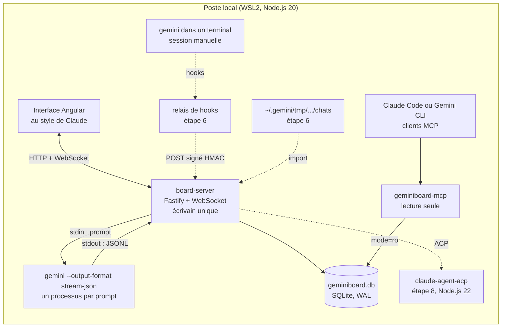
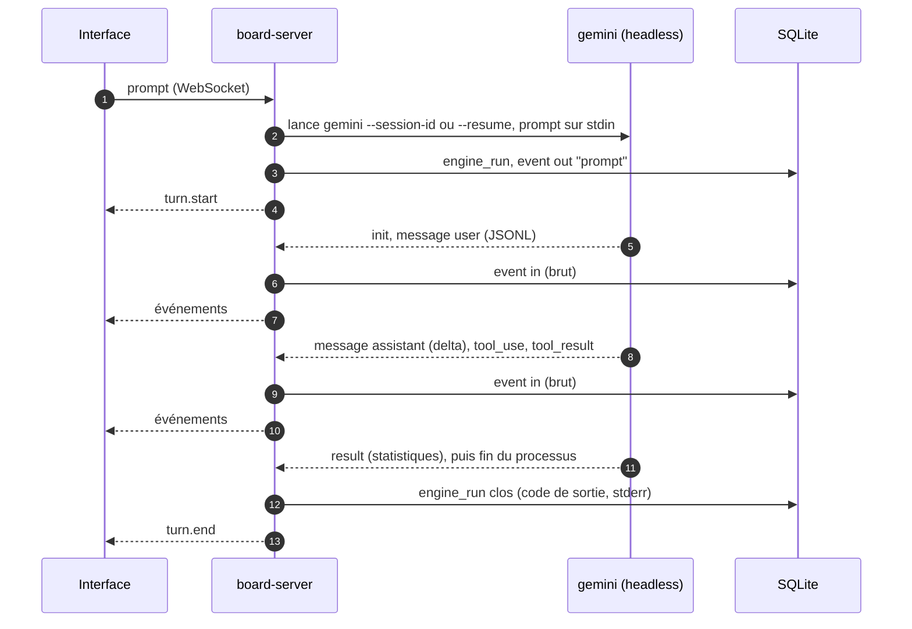
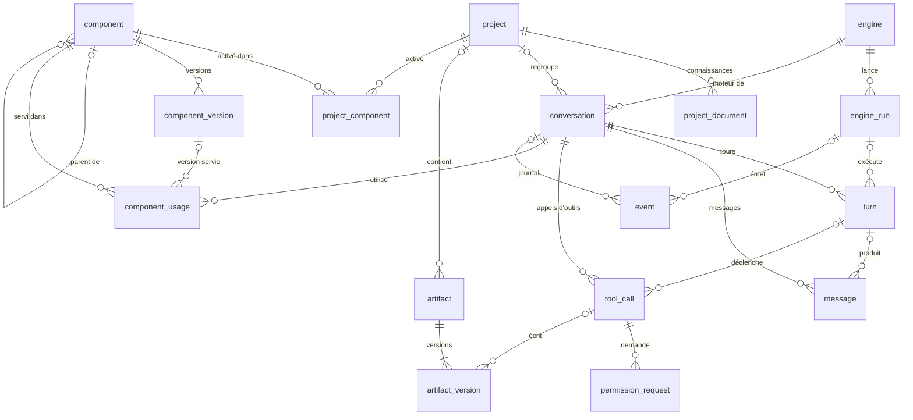

# GeminiBoard : cadrage

> **Statut** : v0.2 ratifiée le 25 octobre 2026 (PR #2) · étape 1 : spike fusionné (PR #3), corpus à collecter · étape 2 en cours : migration, journal et projecteur
>
> **Portée de ce dépôt** : le cadrage, le code du board (D11) et les composants portables (D12).

GeminiBoard est une interface locale, au style de celle de Claude, qui pilote Gemini CLI et gère les discussions, les projets, les artefacts, les sous-agents, les skills, les commandes et les outils. Chaque échange et chaque action de gestion sont journalisés dans **un seul fichier SQLite**, conçu pour être relu par Claude le jour où le travail passera sur Claude. Les composants (skills, sous-agents, commandes, hooks) restent **portables entre Gemini CLI et Claude Code**.

---

## 1. Contexte

- Gemini CLI est l'outil de travail actuel ; le passage à Claude est prévu.
- Gemini CLI se prête mal à la conception de skills et d'agents complexes : ils sont conçus avec Claude, publiés sur GitHub, puis installés dans Gemini CLI.
- Il manque une vue d'ensemble : les sessions sont rangées par projet dans `~/.gemini/tmp/` (30 jours de rétention par défaut), les composants sont dispersés entre dossier utilisateur, espaces de travail et extensions, et les décisions (autorisations, ratifications) ne laissent aucune trace exploitable.
- Gemini CLI publie une version par semaine (v0.65.0 le 20 octobre 2026). Le board conserve donc les événements bruts et versionne ses analyseurs, pour encaisser les changements de format.

GeminiBoard comble ce manque et prépare la transition : son journal devient la mémoire commune quand le travail se fera directement avec Claude.

## 2. Décisions déjà prises

| # | Décision | Date |
|---|---|---|
| D1 | Commandes au format TOML de Gemini CLI | 2026-10-24 |
| D2 | Skills et agents portables entre Gemini CLI et Claude | 2026-10-24 |
| D3 | Node.js ; Angular si le front est complexe | 2026-10-24 |
| D4 | Le schéma SQLite d'abord | 2026-10-24 |
| D5 | Interface au style de celle de Claude | 2026-10-24 |
| D6 | Travail en PR sur GitHub, ratification avant fusion | 2026-10-24 |
| D7 | Projet distinct, qui s'ajoute aux autres | 2026-10-24 |
| D8 | Journal des échanges et gestion dans un fichier SQLite unique, exploitable par Claude | 2026-10-24 |
| D9 | Capture : le board lance Gemini CLI à chaque prompt et relaie sa sortie standard vers l'interface (Q1) | 2026-10-25 |
| D10 | Toutes les bibliothèques sont compatibles avec Node.js 20 (Q2) | 2026-10-25 |
| D11 | Le code du board vit dans ce dépôt (Q5) | 2026-10-25 |
| D12 | Les composants portables vivent aussi dans ce dépôt (Q6) | 2026-10-25 |

Le front visé (flux en continu, panneaux, catalogue) est complexe : ce cadrage retient donc Angular au titre de D3. D10 limite Angular aux versions 20 et 21 (Q3).

## 3. Objectifs et non-objectifs

| # | Objectif | Critère de vérification |
|---|---|---|
| O1 | Tout échange Gemini CLI est retrouvable | Une session lancée depuis le board **ou** depuis un terminal apparaît dans la base, avec ses messages, ses appels d'outils et ses décisions (terminal : étape 6) |
| O2 | L'état est reconstructible | Vider les tables de projection puis rejouer le journal `event` redonne le même état |
| O3 | Claude lit la base sans transformation | Claude répond à « qu'a-t-on décidé sur X ? » par le serveur MCP ou à partir du fichier joint |
| O4 | Un composant écrit une fois sert les deux moteurs | Un skill, une commande et un sous-agent s'installent dans Gemini CLI et dans Claude Code depuis ce dépôt |
| O5 | L'interface est accessible | Parcours clés au clavier et au lecteur d'écran ; cible RGAA 4.1 et WCAG 2.2, niveau AA |

Hors périmètre de la v1 : réimplémenter l'agent (le board pilote Gemini CLI, il ne le remplace pas), le multi-utilisateur, l'hébergement distant, la synchronisation dans le cloud, l'édition collaborative en temps réel.

## 4. Périmètre fonctionnel

| Module | Fonctions |
|---|---|
| Discussions | créer, reprendre, rechercher, renommer, épingler, archiver, bifurquer ; affichage en continu ; interruption ; choix du modèle et du mode d'approbation (`default`, `auto_edit`, `yolo`, `plan`), fixé avant l'envoi |
| Projets | dossier racine et son approbation par l'humain, dépôt, instructions injectées au début de chaque session (sans modifier les fichiers du dépôt), connaissances, composants activés, discussions, politique de capture |
| Artefacts | détection des fichiers écrits par les outils (`write_file`, `replace`), épinglage d'un bloc de code, versions, différences entre versions, export |
| Catalogue | skills, sous-agents, commandes, hooks, serveurs MCP et outils, extensions, fichiers de contexte, politiques : découverte sur disque, versions, statut (brouillon, proposé, ratifié, obsolète), lien vers la PR, activation par projet, usages, export vers Claude |
| Exécutions | lancer une commande ou un agent en lot, suivre le statut et le code de sortie |
| Journal | événements bruts filtrables (source, type, session), rejeu, export |
| Réglages | moteurs détectés et leurs versions, chemins, secret HMAC, motifs de masquage |

## 5. Architecture

### 5.1 Vue d'ensemble

Les liens en pointillés arrivent aux étapes 6 et 8 de la feuille de route.



- **Écrivain unique.** Seul `board-server` écrit dans la base, sur le modèle de l'agent médiateur d'Agent2Dev. Le relais de hooks lui transmettra ses événements ; le serveur MCP lit en lecture seule.
- **Journal d'abord.** Tout ce qui arrive (ligne JSONL, entrée de hook, action dans l'interface) est écrit tel quel dans `event`, puis projeté dans les tables métier. Un arrêt brutal ne perd rien : le rejeu reconstitue les messages à partir de leurs fragments.
- **Adaptateurs de moteur.** Un adaptateur par moteur et par canal : `gemini-cli` en headless pour la v1, puis ACP et `claude-code` à l'étape 8. Le reste du board ignore le moteur, ce qui prépare le passage à Claude.
- **Local.** Tout tourne sur le poste (WSL2, Ubuntu 24.04) ; le navigateur Windows accède au board par `localhost`.

### 5.2 Composants et versions

| Paquet | Rôle | Technologie |
|---|---|---|
| `packages/server` (`board-server`) | lanceur de Gemini CLI (`run-gemini.mjs`), base et migrations (`journal.mjs`), écriture du journal (`recorder.mjs`), projecteur (`projector.mjs`) ; API HTTP et WebSocket à l'étape 4 | Node.js 20 (ES modules), better-sqlite3 ; Fastify et `@fastify/websocket` à l'étape 4 |
| `packages/ui` (`board-ui`) | interface | Angular, Angular CDK |
| `packages/hook` (`geminiboard-hook`) | relais des hooks de Gemini CLI (et de Claude Code) vers le serveur | script Node autonome, sans dépendance |
| `packages/mcp` (`geminiboard-mcp`) | lecture de la base par Claude ou Gemini | serveur MCP stdio, Node.js |
| `packages/cli` (`geminiboard`) | migrations, import, rejeu, export Markdown, génération des variantes Claude | Node.js |

Versions compatibles avec Node.js 20 (D10), vérifiées le 25 octobre 2026 :

| Bibliothèque | Version retenue | Contrainte Node.js |
|---|---|---|
| Gemini CLI (`@google/gemini-cli`) | 0.65.0 | 20 et plus ; exécuté ici sous Node.js 20.20.2 |
| better-sqlite3 | 12.11.1 | 20.x, 22.x, 23.x, 24.x ; la 13 exige Node.js 22 |
| Fastify / `@fastify/websocket` | 5.12.7 / 11.3.4 | testés ici sous Node.js 20.20.2 |
| Angular | 20.x ou 21.x | `^20.19.0` ; la 22 exige Node.js 22.22.3 ou plus |
| `node:sqlite` | écarté | absent de Node.js 20 |
| `@agentclientprotocol/claude-agent-acp` | étape 8 | exige Node.js 22 |

Contrats du serveur (esquisse, précisés à l'étape 4) :

- REST : `/api/projects`, `/api/conversations`, `/api/conversations/:id/timeline`, `/api/artifacts`, `/api/components`, `/api/events`, `/api/search`.
- WebSocket `/ws` : reçoit `prompt` et `cancel` ; émet `turn.start`, `event`, `turn.end`, `turn.error` (implémentation de référence au §6.3).
- Ingestion (étape 6) : `POST /ingest/hook`, signé par HMAC-SHA256 (en-tête `X-GeminiBoard-Signature`).

Stockage local :

```text
~/.geminiboard/
├── geminiboard.db      base SQLite (+ -wal, -shm)
├── blobs/              binaires adressés par sha256 (images, pièces jointes)
├── spool/              événements de hooks en attente si le serveur est arrêté
├── secret              clé HMAC (droits 600)
└── config.json
```

### 5.3 Interface au style de Claude

| Zone | Contenu | Équivalent Claude |
|---|---|---|
| Barre latérale | nouvelle discussion, recherche, discussions récentes et épinglées, projets, artefacts, catalogue, journal, réglages | barre latérale |
| Fil | Markdown rendu au fil de l'eau, cartes d'appels d'outils (statut, entrées, sortie, diff), outils refusés signalés, bouton Arrêter ; demandes d'autorisation en ligne avec ACP (étape 8) | fil de conversation |
| Saisie | palette `/` (commandes et skills du catalogue), `@` (fichiers, sous-agents), pièces jointes, choix du modèle et du mode d'approbation | zone de saisie |
| Panneau de droite | artefact ouvert (rendu, source, versions, diff, copie, téléchargement) ou fiche du projet | panneau d'artefacts |
| Page projet | instructions, connaissances, discussions, composants activés, dossier et son approbation, dépôt | Projets |
| Catalogue | listes par type ; fiche avec versions, statut, PR et usages ; activation ; export vers Claude | propre à GeminiBoard |
| Journal | événements bruts, filtres, rejeu | propre à GeminiBoard |

Accessibilité (O5) : navigation complète au clavier, gestion du focus entre panneaux et dialogues, annonce du flux par une région `aria-live="polite"` phrase par phrase (et non jeton par jeton), contrastes de niveau AA, thèmes clair et sombre, respect de `prefers-reduced-motion`, repères et titres de page.

## 6. Capturer la sortie de Gemini CLI

### 6.1 Principe retenu (D9)

Pour chaque prompt, le board lance un processus Gemini CLI en mode headless et relaie sa sortie standard vers l'interface. La sortie est demandée au format `stream-json` : une ligne JSON par événement, que le board journalise avant de la relayer. La discussion garde sa mémoire d'un prompt à l'autre : le board choisit l'identifiant de session (`--session-id <uuid>` au premier tour), puis reprend la même session (`--resume <uuid>`).



Corrections apportées à l'exemple proposé, vérifiées sur Gemini CLI 0.65.0 :

| Exemple proposé | Correction | Raison |
|---|---|---|
| `npx @google/gemini` | binaire `gemini` du paquet `@google/gemini-cli`, installé une fois | `@google/gemini` n'existe pas sur npm ; `npx` ajoute un délai à chaque prompt |
| prompt en argument positionnel | prompt écrit sur stdin | en 0.65, un argument positionnel ouvre le mode interactif ; un stdin non interactif bascule en headless et accepte jusqu'à 8 Mo |
| `shell: true` | pas de shell (sauf `gemini.cmd` sous Windows, où le prompt ne passe de toute façon pas par la ligne de commande) | apostrophes, guillemets, `$()` ou `;` d'un prompt seraient interprétés par le shell : injection de commande |
| sortie texte | `--output-format stream-json` | événements typés à journaliser : `init`, `message`, `tool_use`, `tool_result`, `error`, `result` |
| morceaux bruts (`data`) | découpage par ligne (`readline`) | un morceau peut couper une ligne JSON en deux |
| une session par prompt | `--session-id <uuid>`, puis `--resume <uuid>` | sinon, chaque prompt repart sans la mémoire de la discussion |
| pas d'arrêt | `SIGINT`, puis `SIGKILL` après 5 s | bouton Arrêter |
| `import { Fastify } from 'fastify'` | `import Fastify from 'fastify'` | Fastify s'exporte par défaut |

### 6.2 Contraintes du mode headless (Gemini CLI 0.65.0)

- **Autorisations.** Personne ne peut confirmer un outil en cours de tour : le moteur de politiques transforme toute demande de confirmation en refus. Le mode d'approbation se choisit donc avant l'envoi : `default` (les outils à confirmer, comme l'écriture de fichiers ou le shell, sont refusés), `auto_edit` (modifications de fichiers acceptées), `yolo` (tout est accepté), `plan` (lecture seule). Des règles de politique (`policies/*.toml`) peuvent autoriser des commandes précises.
- **Dossier approuvé.** Dans un dossier non approuvé, le mode headless s'arrête avec le code 55. Le board ne passe `--skip-trust` que pour un projet dont l'humain a approuvé le dossier (`project.trusted`), et journalise cette décision.
- **Création de la session.** Gemini CLI n'enregistre une session qu'après un tour abouti. Si le premier tour échoue (erreur d'API, par exemple), `--resume` sort ensuite avec le code 42 (« No previous sessions found for this project »). Le board ne reprend donc une session qu'après un `result` en succès ; sinon, il la recrée avec `--session-id`.
- **Codes de sortie.** 0 (succès), 1 (erreur générale), 41 (authentification), 42 (entrée invalide), 52 (configuration), 53 (limite de tours), 55 (dossier non approuvé), 130 (annulation). Une erreur d'API sort avec le statut HTTP modulo 256 (400 donne 144) : seul l'événement `result` fait foi.
- **Événements.** Tous portent `type` et `timestamp` ; champs propres à chaque type, relevés dans le code source (`packages/core/src/output/types.ts`) :

| Type | Champs |
|---|---|
| `init` | `session_id`, `model` |
| `message` | `role` (`user`, `assistant`), `content`, `delta` |
| `tool_use` | `tool_name`, `tool_id`, `parameters` |
| `tool_result` | `tool_id`, `status` (`success`, `error`), `output`, `error` |
| `error` | `severity` (`warning`, `error`), `message` |
| `result` | `status` (`success`, `error`), `error`, `stats` (`total_tokens`, `input_tokens`, `output_tokens`, `cached`, `input`, `duration_ms`, `tool_calls`, `models`) |

### 6.3 Implémentation de référence (Node.js 20)

Le lanceur [`packages/server/src/run-gemini.mjs`](packages/server/src/run-gemini.mjs) lance un tour. L'esquisse `server.mjs` ci-dessous l'expose en WebSocket et journalise chaque événement dans SQLite ; elle entrera dans `packages/server` à l'étape 4. Le prompt ne passe jamais par la ligne de commande : il n'apparaît ni dans `ps`, ni dans `engine_run.argv_json`.

Vérifications du 25 octobre 2026 :

- Lanceur et spike : 13 tests contre un faux Gemini CLI, sous Node.js 20.20.2 et 22.23 (ordre des événements, ligne JSON coupée en deux écritures, prompt piégé transmis intact, `--session-id` puis `--resume`, politiques, codes 42, 55, 130 et 144, binaire absent, paramètres refusés, masquage des chemins).
- Esquisse de serveur : 29 contrôles sous Node.js 20.20.2 (WebSocket de bout en bout, journal SQLite, annulation, règle de reprise après un premier tour en erreur).
- Contre Gemini CLI 0.65.0 réel : sans authentification, sortie 41 ; dans un dossier non approuvé, sortie 55 ; avec `--skip-trust` et une clé invalide, `init` (avec l'UUIDv7 fourni par le board), `message` (prompt intact), `result` en erreur, sortie 144 ; le tour suivant en `--resume` sort avec 42.

<details>
<summary><strong><code>server.mjs</code> (esquisse) : cliquer pour déplier</strong></summary>

```js
// server.mjs : esquisse du board-server. Une route WebSocket pilote Gemini CLI,
// chaque événement est journalisé dans SQLite puis relayé à l'interface.
// Node.js 20 ou plus : fastify 5, @fastify/websocket 11, better-sqlite3 12.
import Fastify from 'fastify';
import websocket from '@fastify/websocket';
import Database from 'better-sqlite3';
import { createHash } from 'node:crypto';
import { mkdirSync, readFileSync } from 'node:fs';
import { dirname } from 'node:path';
import { runGemini } from './run-gemini.mjs';
import { uuidv7 } from './uuidv7.mjs';

function openJournal(dbPath, migrationFile) {
  mkdirSync(dirname(dbPath), { recursive: true });
  const db = new Database(dbPath);
  db.pragma('journal_mode = WAL');
  db.pragma('foreign_keys = ON');
  db.pragma('busy_timeout = 5000');
  if (db.pragma('user_version', { simple: true }) === 0) {
    const sql = readFileSync(migrationFile, 'utf8');
    db.transaction(() => {
      db.exec(sql);
      db.prepare('INSERT INTO schema_migration (version, name, checksum) VALUES (1, ?, ?)')
        .run('001_init', createHash('sha256').update(sql).digest('hex'));
      db.pragma('user_version = 1');
    })();
  }
  return db;
}

// trusted : dossier approuvé par l'humain ; dans le board, lu dans project.trusted
export async function buildServer({ dbPath, migrationFile, bin = 'gemini', cwd = process.cwd(), trusted = false }) {
  const db = openJournal(dbPath, migrationFile);
  const insertEvent = db.prepare(`INSERT INTO event
    (source, direction, type, engine_id, engine_run_id, engine_session_id, payload_json)
    VALUES ('headless', ?, ?, 'gemini-cli', ?, ?, ?)`);
  const insertRun = db.prepare(`INSERT INTO engine_run (id, engine_id, channel, argv_json, cwd, pid)
    VALUES (?, 'gemini-cli', 'headless', ?, ?, ?)`);
  const endRun = db.prepare(`UPDATE engine_run SET ended_at = strftime('%Y-%m-%dT%H:%M:%fZ','now'),
    exit_code = ?, stderr_tail = ? WHERE id = ?`);
  // Gemini CLI n'enregistre une session qu'après un tour abouti : sinon, --resume sort avec 42
  const sessionStarted = db.prepare(`SELECT 1 FROM event
    WHERE engine_session_id = ? AND source = 'headless' AND type = 'result'
      AND json_extract(payload_json, '$.status') = 'success' LIMIT 1`);

  const app = Fastify({ logger: false });
  await app.register(websocket);
  app.addHook('onClose', async () => db.close());

  // Messages reçus  : { type: 'prompt', conversationId?, text, approvalMode?, model? } | { type: 'cancel' }
  // Messages émis   : turn.start, event, turn.end, turn.error
  app.get('/ws', { websocket: true }, (socket) => {
    let current = null;
    const send = (msg) => socket.send(JSON.stringify(msg));

    socket.on('message', async (raw) => {
      let msg;
      try { msg = JSON.parse(raw.toString()); } catch { return send({ type: 'turn.error', message: 'JSON invalide' }); }
      if (msg.type === 'cancel') return current?.cancel();
      if (msg.type !== 'prompt' || typeof msg.text !== 'string') return;
      if (current) return send({ type: 'turn.error', message: 'un tour est déjà en cours' });

      const conversationId = msg.conversationId ?? uuidv7();
      const resume = Boolean(sessionStarted.get(conversationId));
      const runId = uuidv7();
      try {
        current = runGemini({
          prompt: msg.text, cwd, sessionId: conversationId, resume,
          approvalMode: msg.approvalMode ?? 'default', model: msg.model, skipTrust: trusted, bin,
          onEvent: (event) => {
            insertEvent.run('in', String(event.type), runId, conversationId, JSON.stringify(event));
            send({ type: 'event', conversationId, event });
          },
        });
      } catch (e) {
        return send({ type: 'turn.error', conversationId, message: e.message });
      }
      // Synchrone, donc écrit avant le premier événement reçu ; le prompt n'est pas dans argv
      insertRun.run(runId, JSON.stringify([bin, ...current.args]), cwd, current.pid ?? null);
      insertEvent.run('out', 'prompt', runId, conversationId,
        JSON.stringify({ text: msg.text, approvalMode: msg.approvalMode ?? 'default', resume }));
      send({ type: 'turn.start', conversationId, resume });

      try {
        const r = await current.done;
        endRun.run(r.code, r.stderr.slice(-4096), runId);
        send({ type: 'turn.end', conversationId, code: r.code, meaning: r.meaning });
      } catch (e) {
        endRun.run(null, e.message, runId);
        send({ type: 'turn.error', conversationId, message: e.message });
      } finally {
        current = null;
      }
    });

    socket.on('close', () => current?.cancel());
  });

  return app;
}

// Lancement direct : node server.mjs
if (import.meta.url === `file://${process.argv[1]}`) {
  const home = process.env.HOME ?? '.';
  const app = await buildServer({
    dbPath: process.env.GEMINIBOARD_DB ?? `${home}/.geminiboard/geminiboard.db`,
    migrationFile: new URL('./migrations/001_init.sql', import.meta.url),
  });
  await app.listen({ host: '127.0.0.1', port: Number(process.env.PORT ?? 3210) });
}
```

</details>

### 6.4 Canaux complémentaires

| Canal | Étape | Usage |
|---|---|---|
| Hooks (`~/.gemini/settings.json` → `geminiboard-hook`) | 6 | sessions lancées à la main dans un terminal (O1) : `SessionStart`, `BeforeAgent`, `BeforeTool`, `AfterTool`, `AfterAgent`, `SessionEnd` |
| Import de `~/.gemini/tmp/<project_hash>/chats/` | 6 | rattrapage de l'historique ; format non documenté |
| ACP (`gemini --acp`) | 8 | autorisations en cours de tour ; même protocole pour Claude Code avec `claude-agent-acp`, qui exige Node.js 22 |

Une session moteur ne donne qu'une discussion (`UNIQUE (engine_id, engine_session_id)`), projetée par un seul canal ; les autres restent consignés dans le journal brut.

Le relais de hooks obéira à trois règles :

1. Il n'écrit sur stdout que `{}` et sort avec le code 0 : il n'influe jamais sur les décisions de Gemini CLI.
2. Il poste l'entrée reçue au serveur avec une signature HMAC et un délai court ; si le serveur ne répond pas, il ajoute l'événement au `spool/`, que le serveur ingère au démarrage.
3. Par défaut, il ne s'abonne ni à `BeforeModel`, ni à `AfterModel`, ni à `BeforeToolSelection` : leur entrée contient la requête complète envoyée au modèle (volume important, données sensibles).

```json
{
  "hooks": {
    "BeforeTool": [
      {
        "matcher": "*",
        "hooks": [
          {
            "name": "geminiboard",
            "type": "command",
            "command": "node \"$HOME/.geminiboard/bin/geminiboard-hook.mjs\"",
            "timeout": 2000
          }
        ]
      }
    ]
  }
}
```

La même entrée sera déclarée pour `SessionStart`, `BeforeAgent`, `AfterTool`, `AfterAgent`, `SessionEnd`, `Notification` et `PreCompress`.

## 7. Schéma SQLite

Source : [`migrations/001_init.sql`](migrations/001_init.sql), appliquée par `packages/server/src/journal.mjs`. Évolutions depuis la v0 du cadrage : colonne `turn.error_message` ; identifiant d'appel d'outil unique par tour, et non plus par discussion, car chaque tour headless est un nouveau processus.

### 7.1 Principes

- Un fichier unique, mode WAL, clés étrangères actives, tables `STRICT`.
- Le journal brut `event` est en ajout seul (garanti par des triggers) et constitue la seule source de vérité. Les autres tables sont des projections reconstructibles ; chaque événement traité porte la version du projecteur.
- Le projecteur (`packages/server/src/projector.mjs`) traite un tour d'un bloc, dans une transaction, une fois son exécution close. Les horodatages viennent des événements et la clé d'un artefact dérive de son chemin (UUID version 8) : le rejeu est déterministe.
- Une migration appliquée ne se modifie plus (empreinte sha256 vérifiée à l'ouverture) : toute évolution passe par un fichier `002_*.sql`.
- Une session moteur correspond à une seule discussion, quel que soit le canal. En headless, l'identifiant de la discussion sert d'identifiant de session à Gemini CLI.
- Clés : UUIDv7 (texte) pour les entités exposées dans les URL, l'API et le MCP (projet, discussion, artefact, composant, exécution) ; entiers pour les tables à fort volume, dont le rowid stable sert de clé aux index plein texte.
- Recherche plein texte FTS5 insensible aux accents (`unicode61 remove_diacritics 2`) sur les messages, les artefacts et les connaissances.
- Binaires hors base (`blobs/`, adressés par sha256) ; textes en base.
- Le catalogue versionne chaque composant avec un statut de ratification, calqué sur le cycle proposer, ratifier, appliquer.
- Les décisions humaines (approbation d'un dossier, autorisations, ratifications, retours) sont des données de premier rang.

### 7.2 Diagramme



### 7.3 Tables

| Groupe | Table | Contenu |
|---|---|---|
| Méta | `schema_migration`, `setting` | migrations appliquées (avec leur sha256), réglages |
| Moteurs | `engine` | `gemini-cli`, `claude-code`, version détectée |
| | `engine_run` | processus lancé par le board : canal, argv (sans le prompt), pid, code de sortie, fin de stderr |
| Projets | `project` | dossier racine et son approbation (`trusted`), dépôt, instructions, `gemini_project_hash`, politique de capture |
| | `project_document` | connaissances du projet (texte indexé ou binaire) |
| Discussions | `conversation` | moteur, `engine_session_id`, canal, modèle, mode d'approbation, statut, discussion parente |
| | `turn` | un prompt et ses suites : statut, raison d'arrêt, message d'erreur, jetons, durée, commande d'origine |
| | `message` | rôles `user`, `assistant`, `thought`, `system` ; séquence partagée avec `tool_call` |
| | `tool_call` | outil, nature (`read`, `edit`, `execute`…), identifiant d'appel unique dans le tour, entrées, sortie, fichiers touchés, statut, composant concerné |
| | `permission_request` | options proposées, décision, auteur de la décision (`human`, `policy`, `hook`, `auto`) ; alimentée à partir de l'étape 8 (ACP) |
| Artefacts | `artifact`, `artifact_version` | fichier ou bloc suivi ; versions avec leur origine (outil, message, humain) |
| Catalogue | `component` | skill, sous-agent, commande, hook, serveur MCP, outil, extension, fichier de contexte, politique ; portée, dépôt source, cibles (`gemini`, `claude`, `both`) |
| | `component_version` | contenu, empreinte, statut (`draft`, `proposed`, `ratified`, `deprecated`), commit, PR |
| | `project_component` | activation par projet, version épinglée |
| | `component_usage` | quelle version a servi dans quelle discussion (`activated`, `invoked`, `delegated`, `fired`, `blocked`) |
| Journal | `event` | entrée brute (`headless`, `hook`, `import`, `acp`, `pty`, `board`), sens, type, session, charge JSON, état de projection |
| Retours | `feedback` | note et commentaire sur un message, un appel, un tour ou une version |
| Lecture | `v_timeline`, `v_conversation_overview`, `v_component_current` | vues stables pour l'interface, le serveur MCP et Claude |

### 7.4 Règles de projection

Règles appliquées par `projector.mjs` (version 1) :

| Entrée | Projection |
|---|---|
| Prompt envoyé (`event` sortant `prompt`) | discussion créée au premier tour (`channel = headless`, identifiant = identifiant de session, titre tiré de la première ligne, projet dont le dossier contient `cwd`) ; nouveau `turn` ; `message` `user` avec le texte envoyé ; commande d'origine si le prompt commence par `/` |
| `message` `user` (écho de Gemini CLI) | reste dans le journal, sans doublon dans `message` |
| `init` | modèle du tour et de la discussion |
| `message` `assistant` | fragments réunis en un seul message, clos au premier `tool_use`, au `result` ou à la fin du tour |
| `tool_use`, puis `tool_result` | `tool_call` (clé : `tool_id` dans le tour) : `completed` ou `failed`, sortie, erreur, durée ; sans résultat : `failed`, ou `cancelled` si le tour est annulé |
| `activate_skill`, `invoke_agent` | `component_usage` (`activated`, `delegated`), avec la version courante du composant s'il est au catalogue |
| `write_file` réussi ; `replace` réussi avec instantané | `artifact` (clé dérivée du projet et du chemin relatif) et nouvelle `artifact_version`. L'instantané (`artifact.snapshot`, écrit par le serveur après relecture du fichier) prime sur le contenu de `write_file` ; un `replace` sans instantané ne crée pas de version |
| `error` | reste dans le journal ; son message sert d'erreur du tour à défaut de `result` |
| `result` | tour clos : `success` donne `completed`, `error` donne `error` (raison : `error.type`, message : `error.message`) ; jetons et durée tirés de `stats` |
| Fin du processus sans `result` | 130 ou signal : `cancelled` ; 53 : `limit` ; autre code : `error`, avec la dernière ligne de stderr |
| `project.upsert` (action du board) | `project` créé ou mis à jour |
| `conversation.delete` (action du board) | discussion supprimée avec ses projections ; le journal reste et le rejeu respecte la suppression |
| Tour resté ouvert après un arrêt du serveur | clos au redémarrage (`recoverOpenRuns`), puis projeté comme annulé |
| Hooks, import, ACP (étapes 6 et 8) | marqués traités, sans projection, jusqu'à leur étape |

### 7.5 Tests

`npm install`, puis `npm test` (Node.js 20) : 31 tests, dont 30 passent et 1 attend un corpus réel.

- Schéma (6) : migration et empreintes, lecture seule, contraintes, plein texte insensible aux accents, journal en ajout seul, vues.
- Projecteur (10) : tour simple, outils et chronologie, `result` en erreur, fins sans `result`, tours successifs, artefacts et instantanés, composants, tour ouvert et reprise après arrêt, suppression, reconstruction à l'identique (O2).
- Rejeu de corpus (2) : un corpus synthétique produit par le spike avec le faux Gemini CLI, puis chaque dossier `fixtures/spike-*` présent dans le dépôt. Chaque tour est vérifié (statut, message utilisateur, appels d'outils, texte de la réponse), puis la base est reconstruite à l'identique.
- Lanceur (8) et spike (5).

Vérifié le 25 octobre 2026 sous Node.js 20.20.2 (trois exécutions), et sous Node.js 22.23 après une installation propre : better-sqlite3 est un module natif, et changer de version de Node.js impose `npm rebuild`. Les corpus produits par Gemini CLI 0.65.0 réel sans compte valide (authentification absente, erreur d'API, reprise impossible) se rejouent aussi à l'identique.

## 8. Lecture par Claude

Deux voies, au choix selon le contexte.

**Voie 1 : serveur MCP `geminiboard-mcp`** (stdio, lecture seule), déclaré dans Claude Code comme dans Gemini CLI. Gemini peut ainsi interroger son propre historique.

| Outil | Rôle |
|---|---|
| `search` | recherche plein texte dans les messages, les artefacts et les connaissances, filtrable par projet et par période |
| `list_conversations` | discussions récentes, par projet |
| `get_conversation` | une discussion en Markdown : messages, appels d'outils résumés, décisions |
| `get_artifact` | un artefact, à une version donnée |
| `list_components` | catalogue, avec version courante et statut |
| `query` | requête `SELECT` libre : connexion `mode=ro`, `PRAGMA query_only`, nombre de lignes plafonné |

**Voie 2 : fichier joint.** La base, ou un export filtré (`geminiboard export --project <slug>`), est jointe à une session Claude, qui l'interroge en SQL.

Un skill portable, `geminiboard-journal`, indique aux deux moteurs quand et comment interroger le journal. Le contrat de lecture repose sur les vues `v_*` : toute modification passe par une migration et une note de version.

## 9. Portabilité Gemini CLI ↔ Claude Code

État au 25 octobre 2026 (sources en fin de document) :

| Élément | Gemini CLI | Claude Code | Stratégie |
|---|---|---|---|
| Skill | `SKILL.md` (standard Agent Skills) dans `.gemini/skills/` ou son alias `.agents/skills/`, dans `~/.gemini/skills/` ou dans une extension ; activé par l'outil `activate_skill` ; `gemini skills install <url git>` | `SKILL.md` (même standard) dans `.claude/skills/`, `~/.claude/skills/` ou un plugin | **Source unique** ; frontmatter limité à `name` et `description` ; dossiers `scripts/`, `references/`, `assets/` |
| Commande | TOML dans `.gemini/commands/<ns>/<nom>.toml`, appelée par `/ns:nom` ; champs `prompt` et `description` ; `{{args}}`, `!{…}`, `@{…}` | Markdown dans `.claude/commands/`, ou skill ; `description`, `argument-hint` ; `$ARGUMENTS`, ``!`…` ``, `@fichier` | **Source TOML** (D1) ; variante Claude générée |
| Sous-agent | `.gemini/agents/<nom>.md`, frontmatter `name`, `description`, `tools`, `mcp_servers`, `model`, `temperature`, `max_turns`, `timeout_mins` ; réglage `experimental.enableAgents` | `.claude/agents/<nom>.md`, frontmatter `name`, `description`, `tools`, `model`… | source neutre ; deux variantes générées (correspondance des outils ci-dessous) |
| Hooks | `settings.json` ou `hooks/hooks.json` d'une extension ; stdin avec `session_id`, `transcript_path`, `cwd`, `hook_event_name`, `timestamp` ; code 2 pour bloquer ; `timeout` en millisecondes | `settings.json` ou `hooks/hooks.json` d'un plugin ; stdin avec `session_id`, `transcript_path`, `cwd`, `hook_event_name`, `permission_mode` ; code 2 pour bloquer ; `timeout` en secondes | un seul script Node ; correspondance des événements ci-dessous ; délais convertis |
| Contexte | `GEMINI.md` ; `context.fileName` accepte `AGENTS.md` ; `contextFileName` dans une extension ; imports `@fichier.md` | `CLAUDE.md`, ou `AGENTS.md` lu nativement en l'absence de `CLAUDE.md` (v2.1.277 et suivantes) ; imports `@chemin` | **`AGENTS.md` comme source unique** |
| Distribution par GitHub | extension : `gemini-extension.json` à la racine ; `gemini extensions install <url> [--ref] [--auto-update]` | plugin : `.claude-plugin/plugin.json`, publié par une marketplace (`.claude-plugin/marketplace.json`) | ce dépôt sert les deux (arborescence ci-dessous) |

Conversion d'une commande TOML en commande Markdown pour Claude :

| TOML (Gemini CLI) | Markdown (Claude Code) |
|---|---|
| `description = "…"` | frontmatter `description: …` |
| `prompt = """…"""` | corps du fichier |
| `{{args}}` | `$ARGUMENTS` |
| `@{chemin}` | `@chemin` |
| `!{commande}` | ``!`commande` ``, avec un `allowed-tools` adapté |
| `commands/git/commit.toml`, appelée par `/git:commit` | `commands/git-commit.md`, appelée par `/<plugin>:git-commit` |

Correspondance des outils (sous-agents) :

| Gemini CLI | Claude Code |
|---|---|
| `read_file`, `read_many_files` | `Read` |
| `write_file` | `Write` |
| `replace` | `Edit` |
| `run_shell_command` | `Bash` |
| `glob` | `Glob` |
| `grep_search` | `Grep` |
| `web_fetch` | `WebFetch` |
| `google_web_search` | `WebSearch` |
| `activate_skill` | `Skill` |

Correspondance des événements de hooks :

| Gemini CLI | Claude Code |
|---|---|
| `SessionStart` | `SessionStart` |
| `BeforeAgent` | `UserPromptSubmit` |
| `BeforeTool` | `PreToolUse` |
| `AfterTool` | `PostToolUse` |
| `AfterAgent` | `Stop` |
| `PreCompress` | `PreCompact` |
| `Notification` | `Notification` |
| `SessionEnd` | `SessionEnd` |
| `BeforeModel`, `AfterModel`, `BeforeToolSelection` | pas d'équivalent direct |

Arborescence de ce dépôt (D11, D12) : à la fois extension Gemini CLI, marketplace Claude Code et code du board.

```text
geminiboard-cadrage/
├── README.md                        # ce cadrage
├── gemini-extension.json            # extension Gemini CLI, à la racine ; contextFileName = AGENTS.md
├── AGENTS.md                        # contexte, source unique
├── skills/<nom>/SKILL.md            # skills, source unique (dont geminiboard et geminiboard-journal)
├── commands/<ns>/<nom>.toml         # commandes, source TOML
├── agents/<nom>.md                  # sous-agents, variante Gemini (générée)
├── hooks/hooks.json                 # hooks, variante Gemini (relais geminiboard-hook, étape 6)
├── src/agents/<nom>.md              # sous-agents, source neutre
├── claude-plugin/                   # plugin Claude Code (généré)
│   ├── .claude-plugin/plugin.json
│   ├── skills/<nom>/SKILL.md        # copie des skills
│   ├── commands/<ns>-<nom>.md       # générées depuis commands/*.toml
│   ├── agents/<nom>.md              # variante Claude
│   └── hooks/hooks.json             # variante Claude
├── .claude-plugin/marketplace.json  # marketplace Claude ; source du plugin : ./claude-plugin
├── packages/                        # code du board : server, ui, hook, mcp, cli
├── migrations/001_init.sql
├── fixtures/                        # événements réels collectés au spike
└── tools/port.mjs                   # génération et contrôle de portabilité
```

Pourquoi un sous-dossier pour Claude : un plugin Claude charge toujours le `hooks/hooks.json` de sa racine (le manifeste ne fait que s'y ajouter) et ses chemins doivent rester sous sa racine. Placé à la racine du dépôt, il lirait les hooks au format Gemini ; d'où un plugin généré dans `claude-plugin/`, avec une copie des skills. `tools/port.mjs` contrôle aussi les invariants : frontmatter des skills, nom de skill égal au nom du dossier, TOML valide, outils connus des deux côtés.

Conséquence de D11 : `gemini extensions install https://github.com/FredGarcia/geminiboard-cadrage` copie tout le dépôt, code du board compris (sans `node_modules`, qui n'est pas versionné).

## 10. Lecture 7E

> « Les Éléments dans l'Espace Engendrent un État d'Expression Évolutif de l'Environnement »

| Terme | Dans GeminiBoard |
|---|---|
| Éléments | les entités du schéma : projets, discussions, tours, messages, appels d'outils, artefacts, composants |
| Espace | le fichier SQLite unique et l'espace de travail : dossiers racine, `~/.gemini`, dépôts GitHub |
| Engendrent | les événements bruts (stream-json, puis hooks, import et ACP, actions du board), écrits dans `event` |
| État | les projections, reconstructibles par rejeu |
| Expression | l'interface, les vues `v_*`, l'export Markdown, le serveur MCP |
| Évolutif | les versions des composants (du brouillon à la ratification), les migrations, la version du projecteur |
| Environnement | Gemini CLI, Claude Code, GitHub, le système de fichiers, et l'humain qui approuve, autorise et ratifie |

Second ordre : les décisions de l'observateur (approbations, autorisations, ratifications, retours) sont journalisées comme des données. Les agents les relisent par le serveur MCP et ajustent leur conduite ; le système s'observe en train d'être utilisé.

## 11. Sécurité et confidentialité

- Écoute sur `127.0.0.1` uniquement ; le board n'envoie aucune donnée hors du poste.
- Le prompt passe par stdin, jamais par une ligne de commande ni par un shell : pas d'injection, pas de prompt visible dans `ps`.
- `--skip-trust` seulement pour un dossier approuvé par l'humain dans le board (`project.trusted`), décision journalisée.
- Relais de hooks authentifié par HMAC-SHA256 (secret local, droits 600).
- Masquage avant écriture : motifs de secrets configurables (clés d'API, jetons, en-têtes `Authorization`) ; la colonne `event.redacted` trace leur application.
- Politique de capture par projet : `full`, `metadata` (sans contenu) ou `off`.
- La base n'est jamais versionnée. Ce dépôt public ne contient ni données ni extraits de session.
- Lecture par Claude : connexion `mode=ro` et `query_only` ; export filtré pour toute transmission hors du poste.
- Node.js 20 ne reçoit plus de correctifs de sécurité depuis le 30 avril 2026 (Q12).

## 12. Feuille de route

Chaque étape se termine par une ratification en PR.

| Étape | Livrable | Point de ratification |
|---|---|---|
| 0. Cadrage | ce README, décisions D1 à D12 | fusion de cette PR |
| 1. Spike de capture | `spike/capture.mjs` fusionné (PR #3) ; reste à le lancer sur le poste avec un vrai compte et à committer le corpus dans `fixtures/` | corpus |
| 2. Schéma v1 | en cours : `migrations/001_init.sql`, journal, projecteur et rejeu des fixtures ; ajustement au corpus réel dès son arrivée | schéma v1 |
| 3. Skill de construction | skill `geminiboard` et commandes TOML qui guident Gemini CLI dans la construction du board, dans ce dépôt | skill 1.0.0 |
| 4. Serveur | `packages/server` : lanceur, journal, projecteur, API, WebSocket | une discussion de bout en bout |
| 5. Interface | Angular : barre latérale, fil en continu, mode d'approbation, panneau d'artefacts | parcours au clavier et au lecteur d'écran |
| 6. Catalogue et capture passive | découverte et versions des composants ; relais de hooks ; import des sessions | catalogue v1, O1 vérifié |
| 7. Lecture par Claude | `geminiboard-mcp`, skill `geminiboard-journal`, export | O3 vérifié |
| 8. Portabilité et ACP | `tools/port.mjs`, extension et plugin depuis ce dépôt ; ACP pour les autorisations en cours de tour et le moteur Claude (Node.js 22) | O4 vérifié |

Points à trancher par le spike, sur le poste et avec un vrai compte :

- **S1.** Corpus `stream-json` réel : tours avec outils, fragments `delta`, erreurs `error` et `result`.
- **S2.** Reprise `--resume <uuid>` sur plusieurs tours ; comportement si deux tours visent la même session.
- **S3.** Effet réel des modes d'approbation et des règles `policies/*.toml` en headless.
- **S4.** Délai de démarrage d'un processus par prompt sur le poste.

Points repoussés : format des fichiers de session et déclenchement des hooks (étape 6), ACP et `claude-agent-acp` (étape 8).

Tests : le projecteur est vérifié en rejouant les fixtures du spike ; l'interface, par des tests de bout en bout Playwright (le même outillage qu'Agent2Test).

## 13. Questions ouvertes

| # | Question | Proposition ou décision |
|---|---|---|
| Q1 | Canaux de capture | **Tranchée (D9)** : un processus par prompt, sortie relayée en `stream-json` ; hooks et import à l'étape 6, ACP à l'étape 8 |
| Q2 | Pilote SQLite | **Tranchée (D10)** : better-sqlite3 12.11.1, compatible avec Node.js 20 (la 13 exige Node.js 22 ; `node:sqlite` n'existe pas en Node.js 20) |
| Q3 | Version d'Angular | 20, comme le socle back-front d'Agent2Prompt, ou 21 ; la 22 est exclue par D10 |
| Q4 | Bibliothèque de composants | Angular CDK et composants maison, pour coller au style de Claude ; Angular Material en option |
| Q5 | Dépôt du code | **Tranchée (D11)** : ce dépôt |
| Q6 | Dépôt des composants portables | **Tranchée (D12)** : ce dépôt |
| Q7 | Rétention du journal brut | conservation intégrale ; un compactage des fragments après projection exigerait une exception au principe d'ajout seul |
| Q8 | Capture par défaut des projets professionnels | `metadata`, avec passage à `full` projet par projet |
| Q9 | Moteur `claude-code` dans le board | à l'étape 8, avec ACP ; exige Node.js 22 |
| Q10 | Fichier de contexte | `AGENTS.md` comme source unique, déclaré par `context.fileName` côté Gemini CLI |
| Q11 | Mode d'approbation par défaut d'une nouvelle discussion | `default` ; `auto_edit` ou `yolo` sur choix explicite, journalisé |
| Q12 | Passage à Node.js 22 | Node.js 20 n'a plus de correctifs depuis le 30 avril 2026 ; Node.js 22 ouvrirait Angular 22, better-sqlite3 13 et `claude-agent-acp` |
| Q13 | Nom du dépôt | le renommer `geminiboard` maintenant qu'il porte le code (GitHub redirige l'ancienne adresse) |

## 14. Références

Consultées le 25 octobre 2026.

**Gemini CLI**

- [Headless mode](https://www.geminicli.com/docs/cli/headless) · [ACP mode](https://geminicli.com/docs/cli/acp-mode/) · [CLI reference](https://geminicli.com/docs/cli/cli-reference) · [Trusted folders](https://geminicli.com/docs/cli/trusted-folders/)
- [Hooks](https://geminicli.com/docs/hooks/) · [Hooks reference](https://geminicli.com/docs/hooks/reference)
- [Agent Skills](https://geminicli.com/docs/cli/skills/) · [Creating Agent Skills](https://geminicli.com/docs/cli/creating-skills/)
- [Custom commands](https://www.geminicli.com/docs/cli/custom-commands) · [Session management](https://geminicli.com/docs/cli/session-management/)
- [Extension reference](https://geminicli.com/docs/extensions/reference/) · [GEMINI.md](https://geminicli.com/docs/cli/gemini-md/) · [Tools reference](https://geminicli.com/docs/reference/tools)
- [Subagents have arrived in Gemini CLI](https://developers.googleblog.com/en/subagents-have-arrived-in-gemini-cli/)
- [Release v0.65.0](https://github.com/google-gemini/gemini-cli/releases/tag/v0.65.0) · code source : événements `stream-json` dans `packages/core/src/output/types.ts`, options `--acp` et `--experimental-acp` dans `packages/cli/src/config/config.ts`, champs des sous-agents dans `packages/core/src/agents/agentLoader.ts` ; aide (`gemini --help`), codes de sortie et politiques du paquet npm 0.65.0

**Agent Client Protocol**

- [Protocol overview](https://agentclientprotocol.com/protocol/overview)
- [SDK TypeScript `@agentclientprotocol/sdk`](https://github.com/agentclientprotocol/typescript-sdk) · [adaptateur `@agentclientprotocol/claude-agent-acp`](https://github.com/agentclientprotocol/claude-agent-acp)

**Claude Code**

- [Skills](https://code.claude.com/docs/en/skills) · [Subagents](https://code.claude.com/docs/en/sub-agents) · [Hooks](https://code.claude.com/docs/en/hooks)
- [Plugin manifest reference](https://code.claude.com/docs/en/plugins-reference) · [Memory, CLAUDE.md et AGENTS.md](https://code.claude.com/docs/en/memory)

**Node.js 20**

- Compatibilités relevées dans le registre npm (`engines` de better-sqlite3, @angular/core, @google/gemini-cli) · fin de support : [Node.js v20 goes EOL April 30](https://www.herodevs.com/blog-posts/node-js-v20-goes-eol-april-30----and-your-cloud-provider-is-pulling-the-plug-the-next-day)

**Standard** : [Agent Skills](https://agentskills.io)
