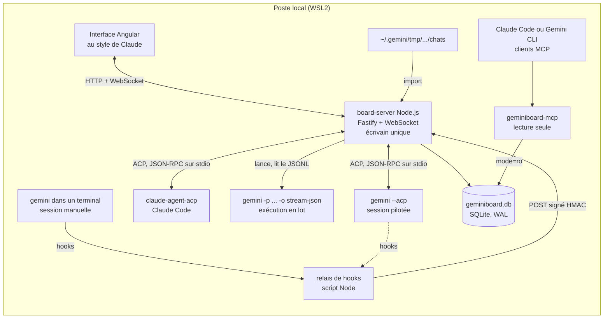
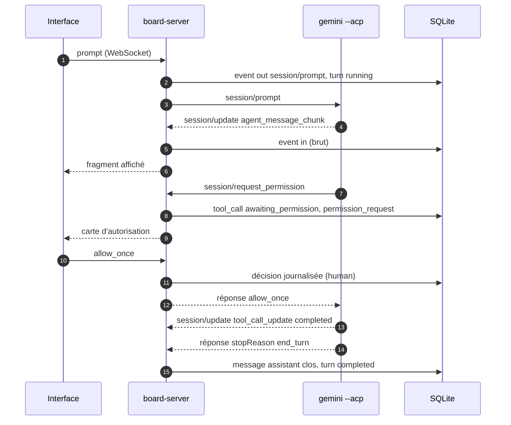
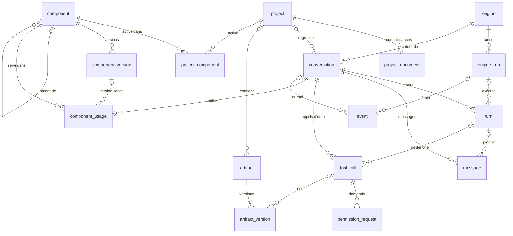

# GeminiBoard : cadrage

> **Statut** : proposition v0, à ratifier par PR · **Date** : 25 octobre 2026
>
> **Portée de ce dépôt** : le cadrage seul. L'emplacement du code est la question Q5.

GeminiBoard est une interface locale, au style de celle de Claude, qui pilote Gemini CLI et gère les discussions, les projets, les artefacts, les sous-agents, les skills, les commandes et les outils. Chaque échange et chaque action de gestion sont journalisés dans **un seul fichier SQLite**, conçu pour être relu par Claude le jour où le travail passera sur Claude. Les composants (skills, sous-agents, commandes, hooks) restent **portables entre Gemini CLI et Claude Code**.

---

## 1. Contexte

- Gemini CLI est l'outil de travail actuel ; le passage à Claude est prévu.
- Gemini CLI se prête mal à la conception de skills et d'agents complexes : ils sont conçus avec Claude, publiés sur GitHub, puis installés dans Gemini CLI.
- Il manque une vue d'ensemble : les sessions sont rangées par projet dans `~/.gemini/tmp/` (30 jours de rétention par défaut), les composants sont dispersés entre dossier utilisateur, espaces de travail et extensions, et les décisions (autorisations, ratifications) ne laissent aucune trace exploitable.
- Gemini CLI publie une version par semaine (v0.65.0 le 20 octobre 2026). Le board conserve donc les événements bruts et versionne ses analyseurs, pour encaisser les changements de format.

GeminiBoard comble ce manque et prépare la transition : son journal devient la mémoire commune quand le travail se fera directement avec Claude.

## 2. Décisions déjà prises

| # | Décision | Date |
|---|---|---|
| D1 | Commandes au format TOML de Gemini CLI | 2026-10-24 |
| D2 | Skills et agents portables entre Gemini CLI et Claude | 2026-10-24 |
| D3 | Node.js ; Angular si le front est complexe | 2026-10-24 |
| D4 | Le schéma SQLite d'abord | 2026-10-24 |
| D5 | Interface au style de celle de Claude | 2026-10-24 |
| D6 | Travail en PR sur GitHub, ratification avant fusion | 2026-10-24 |
| D7 | Projet distinct, qui s'ajoute aux autres | 2026-10-24 |
| D8 | Journal des échanges et gestion dans un fichier SQLite unique, exploitable par Claude | 2026-10-24 |

Le front visé (flux en continu, panneaux, catalogue) est complexe : ce cadrage retient donc Angular au titre de D3.

## 3. Objectifs et non-objectifs

| # | Objectif | Critère de vérification |
|---|---|---|
| O1 | Tout échange Gemini CLI est retrouvable | Une session lancée depuis le board **ou** depuis un terminal apparaît dans la base, avec ses messages, ses appels d'outils et ses décisions |
| O2 | L'état est reconstructible | Vider les tables de projection puis rejouer le journal `event` redonne le même état |
| O3 | Claude lit la base sans transformation | Claude répond à « qu'a-t-on décidé sur X ? » par le serveur MCP ou à partir du fichier joint |
| O4 | Un composant écrit une fois sert les deux moteurs | Un skill, une commande et un sous-agent s'installent dans Gemini CLI et dans Claude Code depuis le même dépôt |
| O5 | L'interface est accessible | Parcours clés au clavier et au lecteur d'écran ; cible RGAA 4.1 et WCAG 2.2, niveau AA |

Hors périmètre de la v1 : réimplémenter l'agent (le board pilote Gemini CLI, il ne le remplace pas), le multi-utilisateur, l'hébergement distant, la synchronisation dans le cloud, l'édition collaborative en temps réel.

## 4. Périmètre fonctionnel

| Module | Fonctions |
|---|---|
| Discussions | créer, reprendre, rechercher, renommer, épingler, archiver, bifurquer ; affichage en continu ; interruption ; choix du moteur, du modèle et du mode d'approbation (`default`, `auto_edit`, `yolo`, `plan`) |
| Projets | dossier racine, dépôt, instructions injectées au début de chaque session (sans modifier les fichiers du dépôt), connaissances, composants activés, discussions, politique de capture |
| Artefacts | détection des fichiers écrits par les outils (`write_file`, `replace`), épinglage d'un bloc de code, versions, différences entre versions, export |
| Catalogue | skills, sous-agents, commandes, hooks, serveurs MCP et outils, extensions, fichiers de contexte, politiques : découverte sur disque, versions, statut (brouillon, proposé, ratifié, obsolète), lien vers la PR, activation par projet, usages, export vers Claude |
| Exécutions | lancer une commande ou un agent en lot, suivre le statut et le code de sortie |
| Journal | événements bruts filtrables (source, type, session), rejeu, export |
| Réglages | moteurs détectés et leurs versions, chemins, secret HMAC, motifs de masquage |

## 5. Architecture

### 5.1 Vue d'ensemble



- **Écrivain unique.** Seul `board-server` écrit dans la base, sur le modèle de l'agent médiateur d'Agent2Dev. Le relais de hooks lui transmet ses événements ; le serveur MCP lit en lecture seule.
- **Journal d'abord.** Tout ce qui arrive (trame ACP, ligne JSONL, entrée de hook, action dans l'interface) est écrit tel quel dans `event`, puis projeté dans les tables métier. Un arrêt brutal ne perd rien : le rejeu reconstitue les messages à partir de leurs fragments.
- **Adaptateurs de moteur.** Un adaptateur par moteur et par canal (`gemini-cli` en ACP, `gemini-cli` en headless, `claude-code` en ACP). Le reste du board ignore le moteur, ce qui prépare le passage à Claude.
- **Local.** Tout tourne sur le poste (WSL2, Ubuntu 24.04) ; le navigateur Windows accède au board par `localhost`.

### 5.2 Composants

| Paquet | Rôle | Technologie |
|---|---|---|
| `packages/server` (`board-server`) | API HTTP, WebSocket vers l'interface, adaptateurs de moteur, projecteur, écriture SQLite | Node.js (ES modules), Fastify, `@fastify/websocket`, `@agentclientprotocol/sdk`, better-sqlite3 |
| `packages/ui` (`board-ui`) | interface | Angular, Angular CDK |
| `packages/hook` (`geminiboard-hook`) | relais des hooks de Gemini CLI (et de Claude Code) vers le serveur | script Node autonome, sans dépendance |
| `packages/mcp` (`geminiboard-mcp`) | lecture de la base par Claude ou Gemini | serveur MCP stdio, Node.js |
| `packages/cli` (`geminiboard`) | migrations, import, rejeu, export Markdown, génération des variantes Claude | Node.js |

Contrats du serveur (esquisse, précisés à l'étape 4) :

- REST : `/api/projects`, `/api/conversations`, `/api/conversations/:id/timeline`, `/api/conversations/:id/prompt`, `/api/conversations/:id/cancel`, `/api/permissions/:id`, `/api/artifacts`, `/api/components`, `/api/events`, `/api/search`.
- WebSocket : `timeline.append`, `timeline.update`, `permission.request`, `turn.status`.
- Ingestion : `POST /ingest/hook`, signé par HMAC-SHA256 (en-tête `X-GeminiBoard-Signature`).

Stockage local :

```text
~/.geminiboard/
├── geminiboard.db      base SQLite (+ -wal, -shm)
├── blobs/              binaires adressés par sha256 (images, pièces jointes)
├── spool/              événements de hooks en attente si le serveur est arrêté
├── secret              clé HMAC (droits 600)
└── config.json
```

### 5.3 Interface au style de Claude

| Zone | Contenu | Équivalent Claude |
|---|---|---|
| Barre latérale | nouvelle discussion, recherche, discussions récentes et épinglées, projets, artefacts, catalogue, journal, réglages | barre latérale |
| Fil | Markdown rendu au fil de l'eau, pensées repliables, cartes d'appels d'outils (statut, entrées, sortie, diff), demandes d'autorisation en ligne, bouton Arrêter | fil de conversation |
| Saisie | palette `/` (commandes et skills du catalogue), `@` (fichiers, sous-agents), pièces jointes, choix du moteur, du modèle et du mode d'approbation | zone de saisie |
| Panneau de droite | artefact ouvert (rendu, source, versions, diff, copie, téléchargement) ou fiche du projet | panneau d'artefacts |
| Page projet | instructions, connaissances, discussions, composants activés, dossier, dépôt | Projets |
| Catalogue | listes par type ; fiche avec versions, statut, PR et usages ; activation ; export vers Claude | propre à GeminiBoard |
| Journal | événements bruts, filtres, rejeu | propre à GeminiBoard |

Accessibilité (O5) : navigation complète au clavier, gestion du focus entre panneaux et dialogues, annonce du flux par une région `aria-live="polite"` phrase par phrase (et non jeton par jeton), contrastes de niveau AA, thèmes clair et sombre, respect de `prefers-reduced-motion`, repères et titres de page.

## 6. Capturer la sortie de Gemini CLI

Rediriger la sortie standard de l'interface interactive ne donne qu'un écran ANSI, difficile à analyser. Gemini CLI offre des canaux structurés ; le board les combine.

| Canal | Mécanisme | Ce qu'on obtient | Limites | Rôle proposé |
|---|---|---|---|---|
| **ACP** | `gemini --acp` (l'ancien `--experimental-acp` est déprécié) : JSON-RPC 2.0 sur stdio, le board est client ACP | fragments de message et de pensée, appels d'outils et leurs mises à jour, plan, commandes disponibles ; autorisations en aller-retour (`session/request_permission`) ; sessions (`session/new`, `session/load`, `session/prompt`, `session/cancel`) ; modes d'approbation ; serveurs MCP fournis par le client ; fichiers lus et écrits par l'intermédiaire du client | protocole en évolution (la v2 est expérimentale dans le SDK) | **Principal**, pour les discussions pilotées depuis le board. Même protocole pour Claude Code avec `@agentclientprotocol/claude-agent-acp` |
| **Headless** | `gemini -p "…" --output-format stream-json`, reprise par `--resume` | JSONL : `init`, `message`, `tool_use`, `tool_result`, `error`, `result` ; codes de sortie 0, 1, 42 (entrée invalide), 53 (limite de tours) | un processus par tour ; pas d'autorisation interactive (mode d'approbation ou politiques) | **Exécutions en lot** : agents et commandes lancés sans interface |
| **Hooks** | section `hooks` de `~/.gemini/settings.json`, qui appelle `geminiboard-hook` | événements de cycle de vie (`SessionStart`, `BeforeAgent`, `BeforeTool`, `AfterTool`, `AfterAgent`, `SessionEnd`, etc.), y compris pour une session lancée à la main dans un terminal | aucun rendu ; chaque hook ajoute une latence | **Observation passive** des sessions lancées hors du board |
| **Import** | lecture de `~/.gemini/tmp/<project_hash>/chats/` | historique complet : prompts, réponses, outils, jetons, pensées | format de fichier non documenté | **Rattrapage** et réconciliation |
| PTY | `node-pty` autour de l'interface interactive | l'écran du terminal | non structuré | secours seulement (vue « terminal ») |

**Recommandation (Q1)** : ACP pour les discussions pilotées, hooks pour l'observation passive, import pour le rattrapage, headless pour les lots. La règle de dédoublonnage est simple : une session moteur donne une seule discussion (`UNIQUE (engine_id, engine_session_id)`), projetée par le canal le plus riche qui l'a vue (ACP, puis headless, puis hooks, puis import). Les autres canaux restent consignés dans le journal brut.

Un tour piloté en ACP :



Le relais de hooks obéit à trois règles :

1. Il n'écrit sur stdout que `{}` et sort avec le code 0 : il n'influe jamais sur les décisions de Gemini CLI.
2. Il poste l'entrée reçue au serveur avec une signature HMAC et un délai court ; si le serveur ne répond pas, il ajoute l'événement au `spool/`, que le serveur ingère au démarrage.
3. Par défaut, il ne s'abonne ni à `BeforeModel`, ni à `AfterModel`, ni à `BeforeToolSelection` : leur entrée contient la requête complète envoyée au modèle (volume important, données sensibles).

```json
{
  "hooks": {
    "BeforeTool": [
      {
        "matcher": "*",
        "hooks": [
          {
            "name": "geminiboard",
            "type": "command",
            "command": "node \"$HOME/.geminiboard/bin/geminiboard-hook.mjs\"",
            "timeout": 2000
          }
        ]
      }
    ]
  }
}
```

La même entrée est déclarée pour `SessionStart`, `BeforeAgent`, `AfterTool`, `AfterAgent`, `SessionEnd`, `Notification` et `PreCompress`.

## 7. Schéma SQLite v0

### 7.1 Principes

- Un fichier unique, mode WAL, clés étrangères actives, tables `STRICT`.
- Le journal brut `event` est en ajout seul (garanti par des triggers) et constitue la seule source de vérité. Les autres tables sont des projections reconstructibles ; chaque événement traité porte la version du projecteur.
- Une session moteur correspond à une seule discussion, quel que soit le canal.
- Clés : UUIDv7 (texte) pour les entités exposées dans les URL, l'API et le MCP (projet, discussion, artefact, composant, exécution) ; entiers pour les tables à fort volume, dont le rowid stable sert de clé aux index plein texte.
- Recherche plein texte FTS5 insensible aux accents (`unicode61 remove_diacritics 2`) sur les messages, les artefacts et les connaissances.
- Binaires hors base (`blobs/`, adressés par sha256) ; textes en base.
- Le catalogue versionne chaque composant avec un statut de ratification, calqué sur le cycle proposer, ratifier, appliquer.
- Les décisions humaines (autorisations, ratifications, retours) sont des données de premier rang.

### 7.2 Diagramme



### 7.3 Tables

| Groupe | Table | Contenu |
|---|---|---|
| Méta | `schema_migration`, `setting` | migrations appliquées (avec leur sha256), réglages |
| Moteurs | `engine` | `gemini-cli`, `claude-code`, version détectée |
| | `engine_run` | processus lancé par le board : canal, argv, pid, code de sortie, fin de stderr |
| Projets | `project` | dossier racine, dépôt, instructions, `gemini_project_hash`, politique de capture |
| | `project_document` | connaissances du projet (texte indexé ou binaire) |
| Discussions | `conversation` | moteur, `engine_session_id`, canal, modèle, mode d'approbation, statut, discussion parente |
| | `turn` | un prompt et ses suites : statut, raison d'arrêt, jetons, durée, commande d'origine |
| | `message` | rôles `user`, `assistant`, `thought`, `system` ; séquence partagée avec `tool_call` |
| | `tool_call` | outil, nature (`read`, `edit`, `execute`…), entrées, sortie, fichiers touchés, statut, composant concerné |
| | `permission_request` | options proposées, décision, auteur de la décision (`human`, `policy`, `hook`, `auto`) |
| Artefacts | `artifact`, `artifact_version` | fichier ou bloc suivi ; versions avec leur origine (outil, message, humain) |
| Catalogue | `component` | skill, sous-agent, commande, hook, serveur MCP, outil, extension, fichier de contexte, politique ; portée, dépôt source, cibles (`gemini`, `claude`, `both`) |
| | `component_version` | contenu, empreinte, statut (`draft`, `proposed`, `ratified`, `deprecated`), commit, PR |
| | `project_component` | activation par projet, version épinglée |
| | `component_usage` | quelle version a servi dans quelle discussion (`activated`, `invoked`, `delegated`, `fired`, `blocked`) |
| Journal | `event` | entrée brute (`acp`, `headless`, `hook`, `import`, `pty`, `board`), sens, type, session, charge JSON, état de projection |
| Retours | `feedback` | note et commentaire sur un message, un appel, un tour ou une version |
| Lecture | `v_timeline`, `v_conversation_overview`, `v_component_current` | vues stables pour l'interface, le serveur MCP et Claude |

### 7.4 Règles de projection

| Entrée | Projection |
|---|---|
| ACP : réponse à `session/new` | `conversation` (`channel = acp`, `engine_session_id` = identifiant de session) |
| ACP : envoi de `session/prompt` | `turn` (`running`) et `message` `user` |
| `session/update` : fragments de message ou de pensée | tampon en mémoire, puis `message` `assistant` ou `thought` écrit à sa clôture (début d'un appel d'outil ou fin du tour) ; les fragments restent dans `event` |
| `session/update` : appel d'outil, puis mises à jour | `tool_call`, dont le statut et la sortie évoluent |
| `session/request_permission` et sa réponse | `permission_request`, puis décision horodatée |
| Réponse à `session/prompt` (`stopReason`) | `turn` clos : `end_turn` donne `completed`, `cancelled` donne `cancelled`, `refusal` donne `refused`, `max_tokens` et `max_turn_requests` donnent `limit` |
| stream-json : `init`, `message`, `tool_use`, `tool_result`, `result` | mêmes tables ; `result` porte les statistiques du tour, le code de sortie va dans `engine_run` |
| Hooks `SessionStart`, `BeforeAgent`, `BeforeTool`, `AfterTool`, `AfterAgent`, `SessionEnd` | mêmes tables, seulement si aucun canal plus riche ne projette déjà la session |
| Appel `write_file` ou `replace` terminé | `artifact` (clé : projet et chemin) et nouvelle `artifact_version`, lue sur disque |
| `activate_skill`, commande `/ns:nom`, délégation à un sous-agent, hook bloquant | `component_usage`, avec la version courante du composant |
| Action dans l'interface (créer un projet, ratifier une version…) | `event` (`source = board`, `direction = internal`), puis la table concernée |
| Suppression d'une discussion | événement de suppression ; les projections partent en cascade, le journal reste, le rejeu respecte la suppression |

### 7.5 Validation

Le DDL ci-dessous a été exécuté le 25 octobre 2026 avec `node:sqlite` (Node.js 22.23, SQLite 3.53.4) et avec better-sqlite3 13.0.3 (SQLite 3.53.4). Les 35 contrôles passent avec les deux pilotes : migration, `integrity_check`, `foreign_key_check`, recherche insensible aux accents, mise à jour des index plein texte, journal en ajout seul, contraintes `CHECK`, `UNIQUE` et `STRICT`, vues, suppression en cascade et `VACUUM`. Le script de contrôle sera livré avec la migration à l'étape 2.

<details>
<summary><strong>Migration <code>001_init.sql</code> (v0) : cliquer pour déplier</strong></summary>

```sql
-- =====================================================================
-- GeminiBoard : schéma SQLite v0, migration 001_init (proposition à ratifier)
--
-- Fichier unique, mode WAL, un seul écrivain : le serveur du board.
-- Le serveur pose à chaque connexion : journal_mode=WAL, foreign_keys=ON,
-- busy_timeout=5000, synchronous=NORMAL. Le lanceur de migrations exécute
-- ce script dans une transaction, puis inscrit la version dans
-- schema_migration et dans PRAGMA user_version.
--
-- Conventions
--   horodatages : TEXT ISO 8601 UTC à la milliseconde
--   JSON        : TEXT contrôlé par json_valid()
--   booléens    : INTEGER 0/1
--   clés        : TEXT UUIDv7 pour les entités exposées (URL, API, MCP),
--                 INTEGER pour les tables à fort volume (rowid stable,
--                 indispensable aux index plein texte)
-- =====================================================================

-- ---------------------------------------------------------------------
-- 0. Méta
-- ---------------------------------------------------------------------
CREATE TABLE schema_migration (
  version     INTEGER PRIMARY KEY,
  name        TEXT    NOT NULL,
  checksum    TEXT    NOT NULL,                       -- sha256 du script appliqué
  applied_at  TEXT    NOT NULL DEFAULT (strftime('%Y-%m-%dT%H:%M:%fZ','now'))
) STRICT;

CREATE TABLE setting (
  key         TEXT PRIMARY KEY,
  value_json  TEXT NOT NULL CHECK (json_valid(value_json)),
  updated_at  TEXT NOT NULL DEFAULT (strftime('%Y-%m-%dT%H:%M:%fZ','now'))
) STRICT;

-- ---------------------------------------------------------------------
-- 1. Moteurs et exécutions
-- ---------------------------------------------------------------------
CREATE TABLE engine (
  id           TEXT PRIMARY KEY,                      -- 'gemini-cli' | 'claude-code'
  label        TEXT NOT NULL,
  command      TEXT NOT NULL,                         -- binaire lancé par le board
  version      TEXT,                                  -- dernière version détectée
  detected_at  TEXT
) STRICT;

INSERT INTO engine (id, label, command) VALUES
  ('gemini-cli',  'Gemini CLI',            'gemini'),
  ('claude-code', 'Claude Code (via ACP)', 'claude-agent-acp');

CREATE TABLE engine_run (                             -- un processus moteur lancé par le board
  id              TEXT PRIMARY KEY,                   -- UUIDv7
  engine_id       TEXT NOT NULL REFERENCES engine(id),
  engine_version  TEXT,
  channel         TEXT NOT NULL CHECK (channel IN ('acp','headless','pty')),
  argv_json       TEXT NOT NULL CHECK (json_valid(argv_json)),
  cwd             TEXT NOT NULL,
  pid             INTEGER,
  started_at      TEXT NOT NULL DEFAULT (strftime('%Y-%m-%dT%H:%M:%fZ','now')),
  ended_at        TEXT,
  exit_code       INTEGER,                            -- headless : 0, 1, 42, 53
  stderr_tail     TEXT                                -- fin de stderr, pour le diagnostic
) STRICT;

-- ---------------------------------------------------------------------
-- 2. Projets
-- ---------------------------------------------------------------------
CREATE TABLE project (
  id                   TEXT PRIMARY KEY,              -- UUIDv7
  slug                 TEXT NOT NULL UNIQUE,
  name                 TEXT NOT NULL,
  description          TEXT,
  instructions         TEXT,                          -- instructions du projet, injectées à chaque session
  root_path            TEXT UNIQUE,                   -- dossier racine (cwd des sessions)
  gemini_project_hash  TEXT,                          -- clé du dossier ~/.gemini/tmp/<hash>/
  repo_url             TEXT,
  capture              TEXT NOT NULL DEFAULT 'full'
                       CHECK (capture IN ('full','metadata','off')),  -- politique de capture du projet
  created_at           TEXT NOT NULL DEFAULT (strftime('%Y-%m-%dT%H:%M:%fZ','now')),
  updated_at           TEXT NOT NULL DEFAULT (strftime('%Y-%m-%dT%H:%M:%fZ','now')),
  archived_at          TEXT
) STRICT;

CREATE TABLE project_document (                       -- connaissances du projet
  id           INTEGER PRIMARY KEY,
  project_id   TEXT    NOT NULL REFERENCES project(id) ON DELETE CASCADE,
  title        TEXT    NOT NULL,
  source       TEXT    NOT NULL CHECK (source IN ('upload','path','url','artifact')),
  location     TEXT,                                  -- chemin, URL ou identifiant d'artefact
  mime         TEXT    NOT NULL DEFAULT 'text/markdown',
  content      TEXT,                                  -- texte indexé (NULL si binaire)
  blob_sha256  TEXT,                                  -- binaire rangé dans blobs/<sha256>
  sha256       TEXT    NOT NULL,
  size_bytes   INTEGER NOT NULL,
  created_at   TEXT    NOT NULL DEFAULT (strftime('%Y-%m-%dT%H:%M:%fZ','now')),
  updated_at   TEXT    NOT NULL DEFAULT (strftime('%Y-%m-%dT%H:%M:%fZ','now')),
  CHECK (content IS NOT NULL OR blob_sha256 IS NOT NULL)
) STRICT;
CREATE INDEX ix_project_document_project ON project_document(project_id);

-- ---------------------------------------------------------------------
-- 3. Catalogue : skills, sous-agents, commandes, hooks, serveurs MCP,
--    outils, extensions, fichiers de contexte, politiques
-- ---------------------------------------------------------------------
CREATE TABLE component (
  id             TEXT PRIMARY KEY,                    -- UUIDv7
  kind           TEXT NOT NULL CHECK (kind IN ('skill','agent','command','hook','mcp_server',
                                               'tool','extension','context_file','policy')),
  name           TEXT NOT NULL,                       -- 'agent-tdd-jira', 'git:commit', 'frontend-specialist'
  scope          TEXT NOT NULL CHECK (scope IN ('builtin','extension','user','workspace','board')),
  project_id     TEXT REFERENCES project(id) ON DELETE CASCADE,     -- renseigné pour le scope workspace
  parent_id      TEXT REFERENCES component(id) ON DELETE CASCADE,   -- extension -> composants ; serveur MCP -> outils
  description    TEXT,
  source_repo    TEXT,                                -- 'FredGarcia/Agent2Prompt'
  source_path    TEXT,                                -- chemin dans le dépôt ou sur disque
  targets        TEXT NOT NULL DEFAULT 'gemini' CHECK (targets IN ('gemini','claude','both')),
  enabled        INTEGER NOT NULL DEFAULT 1 CHECK (enabled IN (0,1)),
  meta_json      TEXT CHECK (meta_json IS NULL OR json_valid(meta_json)),
  discovered_at  TEXT NOT NULL DEFAULT (strftime('%Y-%m-%dT%H:%M:%fZ','now')),
  updated_at     TEXT NOT NULL DEFAULT (strftime('%Y-%m-%dT%H:%M:%fZ','now')),
  CHECK ((scope = 'workspace') = (project_id IS NOT NULL))
) STRICT;
CREATE UNIQUE INDEX ux_component_identity
  ON component(kind, scope, ifnull(project_id, ''), ifnull(parent_id, ''), name);
CREATE INDEX ix_component_parent ON component(parent_id);

CREATE TABLE component_version (
  id            INTEGER PRIMARY KEY,
  component_id  TEXT    NOT NULL REFERENCES component(id) ON DELETE CASCADE,
  version       TEXT    NOT NULL,                     -- semver
  status        TEXT    NOT NULL DEFAULT 'draft'
                CHECK (status IN ('draft','proposed','ratified','deprecated')),
  format        TEXT    NOT NULL CHECK (format IN ('skill-md','command-toml','command-md','agent-md',
                                                   'hooks-json','extension-json','plugin-json',
                                                   'mcp-json','context-md','policy-toml','other')),
  content       TEXT    NOT NULL,                     -- manifeste principal (SKILL.md, .toml, .md d'agent)
  files_json    TEXT    CHECK (files_json IS NULL OR json_valid(files_json)),  -- [{path, sha256, size}]
  sha256        TEXT    NOT NULL,                     -- empreinte de l'arborescence complète
  git_ref       TEXT,                                 -- commit ou tag d'origine
  pr_url        TEXT,                                 -- PR de ratification
  ratified_at   TEXT,
  created_at    TEXT    NOT NULL DEFAULT (strftime('%Y-%m-%dT%H:%M:%fZ','now')),
  UNIQUE (component_id, version),
  CHECK (status <> 'ratified' OR ratified_at IS NOT NULL)
) STRICT;

CREATE TABLE project_component (                      -- composants activés pour un projet
  project_id         TEXT    NOT NULL REFERENCES project(id) ON DELETE CASCADE,
  component_id       TEXT    NOT NULL REFERENCES component(id) ON DELETE CASCADE,
  pinned_version_id  INTEGER REFERENCES component_version(id) ON DELETE SET NULL,
  enabled            INTEGER NOT NULL DEFAULT 1 CHECK (enabled IN (0,1)),
  PRIMARY KEY (project_id, component_id)
) STRICT;

-- ---------------------------------------------------------------------
-- 4. Discussions
-- ---------------------------------------------------------------------
CREATE TABLE conversation (
  id                 TEXT PRIMARY KEY,                -- UUIDv7, visible dans l'URL /chat/<id>
  project_id         TEXT REFERENCES project(id) ON DELETE SET NULL,
  engine_id          TEXT NOT NULL REFERENCES engine(id),
  engine_session_id  TEXT,                            -- UUID de session du moteur
  channel            TEXT NOT NULL CHECK (channel IN ('acp','headless','hook','import','pty')),
  title              TEXT,
  cwd                TEXT,
  model              TEXT,
  approval_mode      TEXT,                            -- Gemini : default | auto_edit | yolo | plan
  status             TEXT NOT NULL DEFAULT 'active'
                     CHECK (status IN ('active','idle','ended','archived','error')),
  parent_id          TEXT REFERENCES conversation(id) ON DELETE SET NULL,  -- reprise ou bifurcation
  starred            INTEGER NOT NULL DEFAULT 0 CHECK (starred IN (0,1)),
  summary            TEXT,
  started_at         TEXT NOT NULL DEFAULT (strftime('%Y-%m-%dT%H:%M:%fZ','now')),
  updated_at         TEXT NOT NULL DEFAULT (strftime('%Y-%m-%dT%H:%M:%fZ','now')),
  ended_at           TEXT
) STRICT;
-- Une session moteur = une discussion, quel que soit le canal qui l'a vue
CREATE UNIQUE INDEX ux_conversation_engine_session
  ON conversation(engine_id, engine_session_id) WHERE engine_session_id IS NOT NULL;
CREATE INDEX ix_conversation_recent  ON conversation(updated_at);
CREATE INDEX ix_conversation_project ON conversation(project_id, updated_at);

CREATE TABLE turn (                                   -- un prompt et tout ce qu'il déclenche
  id               INTEGER PRIMARY KEY,
  conversation_id  TEXT    NOT NULL REFERENCES conversation(id) ON DELETE CASCADE,
  seq              INTEGER NOT NULL,                  -- 1, 2, 3... dans la discussion
  engine_run_id    TEXT    REFERENCES engine_run(id) ON DELETE SET NULL,
  command_name     TEXT,                              -- '/git:commit' si le tour part d'une commande
  status           TEXT    NOT NULL DEFAULT 'running'
                   CHECK (status IN ('running','completed','cancelled','refused','limit','error')),
  stop_reason      TEXT,                              -- end_turn, max_tokens, max_turn_requests, refusal, cancelled, code de sortie
  model            TEXT,
  input_tokens     INTEGER,
  output_tokens    INTEGER,
  cached_tokens    INTEGER,
  thought_tokens   INTEGER,
  stats_json       TEXT    CHECK (stats_json IS NULL OR json_valid(stats_json)),
  started_at       TEXT    NOT NULL DEFAULT (strftime('%Y-%m-%dT%H:%M:%fZ','now')),
  ended_at         TEXT,
  duration_ms      INTEGER,
  UNIQUE (conversation_id, seq)
) STRICT;

CREATE TABLE message (
  id                INTEGER PRIMARY KEY,              -- rowid stable : clé de message_fts
  conversation_id   TEXT    NOT NULL REFERENCES conversation(id) ON DELETE CASCADE,
  turn_id           INTEGER REFERENCES turn(id) ON DELETE CASCADE,
  seq               INTEGER NOT NULL,                 -- position dans la chronologie, partagée avec tool_call
  role              TEXT    NOT NULL CHECK (role IN ('user','assistant','thought','system')),
  content           TEXT    NOT NULL,
  content_format    TEXT    NOT NULL DEFAULT 'markdown' CHECK (content_format IN ('markdown','text','json')),
  attachments_json  TEXT    CHECK (attachments_json IS NULL OR json_valid(attachments_json)),
  created_at        TEXT    NOT NULL DEFAULT (strftime('%Y-%m-%dT%H:%M:%fZ','now')),
  completed_at      TEXT,
  UNIQUE (conversation_id, seq)
) STRICT;
CREATE INDEX ix_message_turn ON message(turn_id);

CREATE TABLE tool_call (
  id               INTEGER PRIMARY KEY,
  conversation_id  TEXT    NOT NULL REFERENCES conversation(id) ON DELETE CASCADE,
  turn_id          INTEGER REFERENCES turn(id) ON DELETE CASCADE,
  seq              INTEGER NOT NULL,                  -- même séquence que message
  engine_call_id   TEXT,                              -- toolCallId (ACP) ou identifiant stream-json
  tool_name        TEXT    NOT NULL,                  -- read_file, run_shell_command, activate_skill, outil MCP...
  tool_kind        TEXT    NOT NULL DEFAULT 'other'
                   CHECK (tool_kind IN ('read','edit','delete','move','search','execute',
                                        'think','fetch','skill','agent','mcp','other')),
  component_id     TEXT    REFERENCES component(id) ON DELETE SET NULL,  -- skill, sous-agent ou serveur MCP concerné
  title            TEXT,
  input_json       TEXT    CHECK (input_json IS NULL OR json_valid(input_json)),
  output_text      TEXT,
  locations_json   TEXT    CHECK (locations_json IS NULL OR json_valid(locations_json)),  -- fichiers touchés
  status           TEXT    NOT NULL DEFAULT 'pending'
                   CHECK (status IN ('pending','awaiting_permission','in_progress',
                                     'completed','failed','denied','cancelled')),
  error_message    TEXT,
  started_at       TEXT    NOT NULL DEFAULT (strftime('%Y-%m-%dT%H:%M:%fZ','now')),
  ended_at         TEXT,
  duration_ms      INTEGER,
  UNIQUE (conversation_id, seq)
) STRICT;
CREATE UNIQUE INDEX ux_tool_call_engine
  ON tool_call(conversation_id, engine_call_id) WHERE engine_call_id IS NOT NULL;
CREATE INDEX ix_tool_call_turn ON tool_call(turn_id);
CREATE INDEX ix_tool_call_name ON tool_call(tool_name);

CREATE TABLE permission_request (                     -- demandes d'autorisation et décisions
  id            INTEGER PRIMARY KEY,
  tool_call_id  INTEGER NOT NULL REFERENCES tool_call(id) ON DELETE CASCADE,
  options_json  TEXT    NOT NULL CHECK (json_valid(options_json)),  -- options proposées par le moteur
  decision      TEXT    CHECK (decision IN ('allow_once','allow_always','reject_once',
                                            'reject_always','cancelled','timeout')),
  decided_by    TEXT    CHECK (decided_by IN ('human','policy','hook','auto')),
  reason        TEXT,
  requested_at  TEXT    NOT NULL DEFAULT (strftime('%Y-%m-%dT%H:%M:%fZ','now')),
  decided_at    TEXT,
  CHECK ((decision IS NULL) = (decided_at IS NULL))
) STRICT;
CREATE INDEX ix_permission_tool_call ON permission_request(tool_call_id);

-- ---------------------------------------------------------------------
-- 5. Artefacts
-- ---------------------------------------------------------------------
CREATE TABLE artifact (
  id               TEXT PRIMARY KEY,                  -- UUIDv7
  project_id       TEXT REFERENCES project(id) ON DELETE SET NULL,
  conversation_id  TEXT REFERENCES conversation(id) ON DELETE SET NULL,  -- discussion d'origine
  kind             TEXT NOT NULL CHECK (kind IN ('document','code','html','diagram','data','image','file')),
  title            TEXT NOT NULL,
  path             TEXT,                              -- fichier correspondant dans l'espace de travail
  language         TEXT,                              -- typescript, java, sql, toml, mermaid...
  pinned           INTEGER NOT NULL DEFAULT 0 CHECK (pinned IN (0,1)),
  created_at       TEXT NOT NULL DEFAULT (strftime('%Y-%m-%dT%H:%M:%fZ','now')),
  updated_at       TEXT NOT NULL DEFAULT (strftime('%Y-%m-%dT%H:%M:%fZ','now'))
) STRICT;
CREATE INDEX ix_artifact_project ON artifact(project_id, updated_at);
CREATE INDEX ix_artifact_conversation ON artifact(conversation_id);
CREATE UNIQUE INDEX ux_artifact_path ON artifact(project_id, path) WHERE path IS NOT NULL;

CREATE TABLE artifact_version (
  id            INTEGER PRIMARY KEY,                  -- rowid stable : clé de artifact_fts
  artifact_id   TEXT    NOT NULL REFERENCES artifact(id) ON DELETE CASCADE,
  version       INTEGER NOT NULL,
  content       TEXT,                                 -- texte (NULL si binaire)
  blob_sha256   TEXT,
  mime          TEXT    NOT NULL,
  sha256        TEXT    NOT NULL,
  size_bytes    INTEGER NOT NULL,
  origin        TEXT    NOT NULL CHECK (origin IN ('agent','human','import')),
  message_id    INTEGER REFERENCES message(id) ON DELETE SET NULL,
  tool_call_id  INTEGER REFERENCES tool_call(id) ON DELETE SET NULL,  -- write_file ou replace qui l'a produite
  note          TEXT,
  created_at    TEXT    NOT NULL DEFAULT (strftime('%Y-%m-%dT%H:%M:%fZ','now')),
  UNIQUE (artifact_id, version),
  CHECK (content IS NOT NULL OR blob_sha256 IS NOT NULL)
) STRICT;

-- ---------------------------------------------------------------------
-- 6. Usages des composants (traçabilité : quelle version a servi où)
-- ---------------------------------------------------------------------
CREATE TABLE component_usage (
  id                    INTEGER PRIMARY KEY,
  conversation_id       TEXT    NOT NULL REFERENCES conversation(id) ON DELETE CASCADE,
  turn_id               INTEGER REFERENCES turn(id) ON DELETE CASCADE,
  component_id          TEXT    NOT NULL REFERENCES component(id) ON DELETE CASCADE,
  component_version_id  INTEGER REFERENCES component_version(id) ON DELETE SET NULL,
  usage                 TEXT    NOT NULL CHECK (usage IN ('activated','invoked','delegated','fired','blocked')),
  tool_call_id          INTEGER REFERENCES tool_call(id) ON DELETE SET NULL,
  at                    TEXT    NOT NULL DEFAULT (strftime('%Y-%m-%dT%H:%M:%fZ','now'))
) STRICT;
CREATE INDEX ix_usage_conversation ON component_usage(conversation_id);
CREATE INDEX ix_usage_component ON component_usage(component_id, at);

-- ---------------------------------------------------------------------
-- 7. Journal brut : seule source de vérité, en ajout seul
-- ---------------------------------------------------------------------
CREATE TABLE event (
  id                 INTEGER PRIMARY KEY AUTOINCREMENT,   -- ordre total, jamais réutilisé
  received_at        TEXT    NOT NULL DEFAULT (strftime('%Y-%m-%dT%H:%M:%fZ','now')),
  source             TEXT    NOT NULL CHECK (source IN ('acp','headless','hook','import','pty','board')),
  direction          TEXT    NOT NULL CHECK (direction IN ('in','out','internal')),
                             -- in : moteur -> board ; out : board -> moteur ; internal : action de gestion
  type               TEXT    NOT NULL,                -- 'session/update', 'tool_use', 'BeforeTool', 'project.created'
  engine_id          TEXT    REFERENCES engine(id),
  engine_version     TEXT,
  engine_run_id      TEXT    REFERENCES engine_run(id) ON DELETE SET NULL,
  engine_session_id  TEXT,                            -- clé de rattachement, connue avant la discussion
  conversation_id    TEXT    REFERENCES conversation(id) ON DELETE SET NULL,
  payload_json       TEXT    NOT NULL CHECK (json_valid(payload_json)),
  redacted           INTEGER NOT NULL DEFAULT 0 CHECK (redacted IN (0,1)),  -- masquage appliqué avant écriture
  projected_at       TEXT,                            -- NULL tant que le projecteur ne l'a pas traité
  projector_version  INTEGER
) STRICT;
CREATE INDEX ix_event_conversation ON event(conversation_id, id);
CREATE INDEX ix_event_session ON event(engine_session_id, id) WHERE engine_session_id IS NOT NULL;
CREATE INDEX ix_event_pending ON event(id) WHERE projected_at IS NULL;

CREATE TRIGGER trg_event_no_delete BEFORE DELETE ON event
BEGIN
  SELECT RAISE(ABORT, 'event : journal en ajout seul');
END;

CREATE TRIGGER trg_event_immutable
BEFORE UPDATE OF received_at, source, direction, type, engine_id, engine_version,
                 engine_session_id, payload_json, redacted ON event
BEGIN
  SELECT RAISE(ABORT, 'event : seules les colonnes de rattachement et de projection sont modifiables');
END;

-- ---------------------------------------------------------------------
-- 8. Retours (boucle de second ordre : l'observateur est journalisé)
-- ---------------------------------------------------------------------
CREATE TABLE feedback (
  id           INTEGER PRIMARY KEY,
  target_type  TEXT    NOT NULL CHECK (target_type IN ('message','tool_call','turn',
                                                       'artifact_version','component_version')),
  target_id    TEXT    NOT NULL,                      -- clé de la cible, polymorphe donc sans FK
  rating       INTEGER CHECK (rating IN (-1,0,1)),
  comment      TEXT,
  author       TEXT    NOT NULL DEFAULT 'human',      -- 'human', 'claude', 'gemini' ou nom d'agent
  created_at   TEXT    NOT NULL DEFAULT (strftime('%Y-%m-%dT%H:%M:%fZ','now')),
  CHECK (rating IS NOT NULL OR comment IS NOT NULL)
) STRICT;
CREATE INDEX ix_feedback_target ON feedback(target_type, target_id);

-- ---------------------------------------------------------------------
-- 9. Recherche plein texte (accents ignorés)
-- ---------------------------------------------------------------------
CREATE VIRTUAL TABLE message_fts USING fts5(
  content, content='message', content_rowid='id',
  tokenize = 'unicode61 remove_diacritics 2'
);
CREATE TRIGGER trg_message_fts_insert AFTER INSERT ON message BEGIN
  INSERT INTO message_fts(rowid, content) VALUES (new.id, new.content);
END;
CREATE TRIGGER trg_message_fts_delete AFTER DELETE ON message BEGIN
  INSERT INTO message_fts(message_fts, rowid, content) VALUES ('delete', old.id, old.content);
END;
CREATE TRIGGER trg_message_fts_update AFTER UPDATE OF content ON message BEGIN
  INSERT INTO message_fts(message_fts, rowid, content) VALUES ('delete', old.id, old.content);
  INSERT INTO message_fts(rowid, content) VALUES (new.id, new.content);
END;

CREATE VIRTUAL TABLE artifact_fts USING fts5(
  content, content='artifact_version', content_rowid='id',
  tokenize = 'unicode61 remove_diacritics 2'
);
CREATE TRIGGER trg_artifact_fts_insert AFTER INSERT ON artifact_version BEGIN
  INSERT INTO artifact_fts(rowid, content) VALUES (new.id, new.content);
END;
CREATE TRIGGER trg_artifact_fts_delete AFTER DELETE ON artifact_version BEGIN
  INSERT INTO artifact_fts(artifact_fts, rowid, content) VALUES ('delete', old.id, old.content);
END;
CREATE TRIGGER trg_artifact_fts_update AFTER UPDATE OF content ON artifact_version BEGIN
  INSERT INTO artifact_fts(artifact_fts, rowid, content) VALUES ('delete', old.id, old.content);
  INSERT INTO artifact_fts(rowid, content) VALUES (new.id, new.content);
END;

CREATE VIRTUAL TABLE document_fts USING fts5(
  title, content, content='project_document', content_rowid='id',
  tokenize = 'unicode61 remove_diacritics 2'
);
CREATE TRIGGER trg_document_fts_insert AFTER INSERT ON project_document BEGIN
  INSERT INTO document_fts(rowid, title, content) VALUES (new.id, new.title, new.content);
END;
CREATE TRIGGER trg_document_fts_delete AFTER DELETE ON project_document BEGIN
  INSERT INTO document_fts(document_fts, rowid, title, content)
  VALUES ('delete', old.id, old.title, old.content);
END;
CREATE TRIGGER trg_document_fts_update AFTER UPDATE OF title, content ON project_document BEGIN
  INSERT INTO document_fts(document_fts, rowid, title, content)
  VALUES ('delete', old.id, old.title, old.content);
  INSERT INTO document_fts(rowid, title, content) VALUES (new.id, new.title, new.content);
END;

-- La barre latérale trie les discussions par dernière activité
CREATE TRIGGER trg_message_touch_conversation AFTER INSERT ON message BEGIN
  UPDATE conversation SET updated_at = new.created_at WHERE id = new.conversation_id;
END;

-- ---------------------------------------------------------------------
-- 10. Vues : contrat de lecture stable (interface, MCP, Claude)
-- ---------------------------------------------------------------------
CREATE VIEW v_timeline AS                             -- à lire avec ORDER BY seq
SELECT m.conversation_id, m.seq, 'message' AS item_type, m.id AS item_id,
       m.role AS label, m.content AS body, m.created_at AS at
FROM message m
UNION ALL
SELECT t.conversation_id, t.seq, 'tool_call', t.id,
       t.tool_name || ' [' || t.status || ']',
       coalesce(t.title, t.input_json, ''), t.started_at
FROM tool_call t;

CREATE VIEW v_conversation_overview AS
SELECT c.id, c.title, c.engine_id, c.channel, c.status, c.starred,
       p.name AS project_name, c.started_at, c.updated_at,
       (SELECT count(*) FROM message m   WHERE m.conversation_id = c.id) AS message_count,
       (SELECT count(*) FROM tool_call t WHERE t.conversation_id = c.id) AS tool_call_count,
       (SELECT sum(coalesce(u.input_tokens, 0) + coalesce(u.output_tokens, 0))
          FROM turn u WHERE u.conversation_id = c.id) AS total_tokens
FROM conversation c
LEFT JOIN project p ON p.id = c.project_id;

CREATE VIEW v_component_current AS                    -- dernière version ratifiée, à défaut la plus récente
SELECT c.id, c.kind, c.name, c.scope, c.project_id, c.targets, c.enabled,
       c.source_repo, c.source_path,
       v.id AS version_id, v.version, v.status AS version_status, v.ratified_at, v.pr_url
FROM component c
LEFT JOIN component_version v ON v.id = (
  SELECT x.id FROM component_version x
  WHERE x.component_id = c.id
  ORDER BY (x.status = 'ratified') DESC, x.created_at DESC, x.id DESC
  LIMIT 1
);
```

</details>

## 8. Lecture par Claude

Deux voies, au choix selon le contexte.

**Voie 1 : serveur MCP `geminiboard-mcp`** (stdio, lecture seule), déclaré dans Claude Code comme dans Gemini CLI. Le board peut aussi le fournir à chaque session ACP qu'il ouvre : Gemini interroge alors son propre historique.

| Outil | Rôle |
|---|---|
| `search` | recherche plein texte dans les messages, les artefacts et les connaissances, filtrable par projet et par période |
| `list_conversations` | discussions récentes, par projet |
| `get_conversation` | une discussion en Markdown : messages, appels d'outils résumés, décisions |
| `get_artifact` | un artefact, à une version donnée |
| `list_components` | catalogue, avec version courante et statut |
| `query` | requête `SELECT` libre : connexion `mode=ro`, `PRAGMA query_only`, nombre de lignes plafonné |

**Voie 2 : fichier joint.** La base, ou un export filtré (`geminiboard export --project <slug>`), est jointe à une session Claude, qui l'interroge en SQL.

Un skill portable, `geminiboard-journal`, indique aux deux moteurs quand et comment interroger le journal. Le contrat de lecture repose sur les vues `v_*` : toute modification passe par une migration et une note de version.

## 9. Portabilité Gemini CLI ↔ Claude Code

État au 25 octobre 2026 (sources en fin de document) :

| Élément | Gemini CLI | Claude Code | Stratégie |
|---|---|---|---|
| Skill | `SKILL.md` (standard Agent Skills) dans `.gemini/skills/` ou son alias `.agents/skills/`, dans `~/.gemini/skills/` ou dans une extension ; activé par l'outil `activate_skill` ; `gemini skills install <url git>` | `SKILL.md` (même standard) dans `.claude/skills/`, `~/.claude/skills/` ou un plugin | **Source unique** ; frontmatter limité à `name` et `description` ; dossiers `scripts/`, `references/`, `assets/` |
| Commande | TOML dans `.gemini/commands/<ns>/<nom>.toml`, appelée par `/ns:nom` ; champs `prompt` et `description` ; `{{args}}`, `!{…}`, `@{…}` | Markdown dans `.claude/commands/`, ou skill ; `description`, `argument-hint` ; `$ARGUMENTS`, ``!`…` ``, `@fichier` | **Source TOML** (D1) ; variante Claude générée |
| Sous-agent | `.gemini/agents/<nom>.md`, frontmatter `name`, `description`, `tools`, `mcp_servers`, `model`, `temperature`, `max_turns`, `timeout_mins` ; réglage `experimental.enableAgents` | `.claude/agents/<nom>.md`, frontmatter `name`, `description`, `tools`, `model`… | source neutre ; deux variantes générées (correspondance des outils ci-dessous) |
| Hooks | `settings.json` ou `hooks/hooks.json` d'une extension ; stdin avec `session_id`, `transcript_path`, `cwd`, `hook_event_name`, `timestamp` ; code 2 pour bloquer | `settings.json` ou `hooks/hooks.json` d'un plugin ; stdin avec `session_id`, `transcript_path`, `cwd`, `hook_event_name`, `permission_mode` ; code 2 pour bloquer | un seul script Node ; correspondance des événements ci-dessous |
| Contexte | `GEMINI.md` ; `context.fileName` accepte `AGENTS.md` ; `contextFileName` dans une extension ; imports `@fichier.md` | `CLAUDE.md`, ou `AGENTS.md` lu nativement en l'absence de `CLAUDE.md` (v2.1.277 et suivantes) ; imports `@chemin` | **`AGENTS.md` comme source unique** |
| Distribution par GitHub | extension : `gemini-extension.json` à la racine ; `gemini extensions install <url> [--ref] [--auto-update]` | plugin : `.claude-plugin/plugin.json`, publié par une marketplace (`.claude-plugin/marketplace.json`) | un même dépôt sert les deux (arborescence ci-dessous) |

Conversion d'une commande TOML en commande Markdown pour Claude :

| TOML (Gemini CLI) | Markdown (Claude Code) |
|---|---|
| `description = "…"` | frontmatter `description: …` |
| `prompt = """…"""` | corps du fichier |
| `{{args}}` | `$ARGUMENTS` |
| `@{chemin}` | `@chemin` |
| `!{commande}` | ``!`commande` ``, avec un `allowed-tools` adapté |
| `commands/git/commit.toml`, appelée par `/git:commit` | `commands/git-commit.md`, appelée par `/<plugin>:git-commit` |

Correspondance des outils (sous-agents) :

| Gemini CLI | Claude Code |
|---|---|
| `read_file`, `read_many_files` | `Read` |
| `write_file` | `Write` |
| `replace` | `Edit` |
| `run_shell_command` | `Bash` |
| `glob` | `Glob` |
| `grep_search` | `Grep` |
| `web_fetch` | `WebFetch` |
| `google_web_search` | `WebSearch` |
| `activate_skill` | `Skill` |

Correspondance des événements de hooks :

| Gemini CLI | Claude Code |
|---|---|
| `SessionStart` | `SessionStart` |
| `BeforeAgent` | `UserPromptSubmit` |
| `BeforeTool` | `PreToolUse` |
| `AfterTool` | `PostToolUse` |
| `AfterAgent` | `Stop` |
| `PreCompress` | `PreCompact` |
| `Notification` | `Notification` |
| `SessionEnd` | `SessionEnd` |
| `BeforeModel`, `AfterModel`, `BeforeToolSelection` | pas d'équivalent direct |

Arborescence proposée pour un dépôt de composants, à la fois extension Gemini CLI et marketplace Claude Code :

```text
<depot-composants>/
├── gemini-extension.json            # extension Gemini CLI, à la racine ; contextFileName = AGENTS.md
├── AGENTS.md                        # contexte, source unique
├── skills/<nom>/SKILL.md            # skills, source unique
├── commands/<ns>/<nom>.toml         # commandes, source TOML
├── agents/<nom>.md                  # sous-agents, variante Gemini (générée)
├── hooks/hooks.json                 # hooks, variante Gemini
├── src/agents/<nom>.md              # sous-agents, source neutre
├── claude-plugin/                   # plugin Claude Code (généré)
│   ├── .claude-plugin/plugin.json
│   ├── skills/<nom>/SKILL.md        # copie des skills
│   ├── commands/<ns>-<nom>.md       # générées depuis commands/*.toml
│   ├── agents/<nom>.md              # variante Claude
│   └── hooks/hooks.json             # variante Claude
├── .claude-plugin/marketplace.json  # marketplace Claude ; source du plugin : ./claude-plugin
└── tools/port.mjs                   # génération et contrôle de portabilité
```

Pourquoi un sous-dossier pour Claude : un plugin Claude charge toujours le `hooks/hooks.json` de sa racine (le manifeste ne fait que s'y ajouter) et ses chemins doivent rester sous sa racine. Placé à la racine du dépôt, il lirait les hooks au format Gemini ; d'où un plugin généré dans `claude-plugin/`, avec une copie des skills. `tools/port.mjs` contrôle aussi les invariants : frontmatter des skills, nom de skill égal au nom du dossier, TOML valide, outils connus des deux côtés.

## 10. Lecture 7E

> « Les Éléments dans l'Espace Engendrent un État d'Expression Évolutif de l'Environnement »

| Terme | Dans GeminiBoard |
|---|---|
| Éléments | les entités du schéma : projets, discussions, tours, messages, appels d'outils, artefacts, composants |
| Espace | le fichier SQLite unique et l'espace de travail : dossiers racine, `~/.gemini`, dépôts GitHub |
| Engendrent | les événements bruts (ACP, stream-json, hooks, import, actions du board), écrits dans `event` |
| État | les projections, reconstructibles par rejeu |
| Expression | l'interface, les vues `v_*`, l'export Markdown, le serveur MCP |
| Évolutif | les versions des composants (du brouillon à la ratification), les migrations, la version du projecteur |
| Environnement | Gemini CLI, Claude Code, GitHub, le système de fichiers, et l'humain qui autorise et ratifie |

Second ordre : les décisions de l'observateur (autorisations, ratifications, retours) sont journalisées comme des données. Les agents les relisent par le serveur MCP et ajustent leur conduite ; le système s'observe en train d'être utilisé.

## 11. Sécurité et confidentialité

- Écoute sur `127.0.0.1` uniquement ; le board n'envoie aucune donnée hors du poste.
- Relais de hooks authentifié par HMAC-SHA256 (secret local, droits 600).
- Masquage avant écriture : motifs de secrets configurables (clés d'API, jetons, en-têtes `Authorization`) ; la colonne `event.redacted` trace leur application.
- Politique de capture par projet : `full`, `metadata` (sans contenu) ou `off`.
- La base n'est jamais versionnée. Ce dépôt public ne contient ni données ni extraits de session.
- Le client ACP limite la lecture et l'écriture de fichiers (`fs/read_text_file`, `fs/write_text_file`) aux dossiers du projet.
- Lecture par Claude : connexion `mode=ro` et `query_only` ; export filtré pour toute transmission hors du poste.

## 12. Feuille de route

Chaque étape se termine par une ratification en PR.

| Étape | Livrable | Point de ratification |
|---|---|---|
| 0. Cadrage | ce README | fusion de cette PR |
| 1. Spike de capture | corpus d'événements réels (`fixtures/`) et rapport sur les points S1 à S7 | choix des canaux (Q1) |
| 2. Schéma v1 | `001_init.sql` ajusté au corpus, projecteur rejoué sur les fixtures, script de contrôle | schéma v1 |
| 3. Skill de construction | skill `geminiboard` et commandes TOML qui guident Gemini CLI dans la construction du board, dans le dossier prévu du dépôt Agent2Prompt | skill 1.0.0 |
| 4. Serveur | `board-server` : ACP Gemini, relais de hooks, import, API, WebSocket | une session de bout en bout |
| 5. Interface | barre latérale, fil en continu, autorisations, panneau d'artefacts | parcours au clavier et au lecteur d'écran |
| 6. Catalogue | découverte, versions, ratification, lien vers la PR, activation par projet | catalogue v1 |
| 7. Lecture par Claude | `geminiboard-mcp`, skill `geminiboard-journal`, export | O3 vérifié |
| 8. Portabilité | `tools/port.mjs` ; extension Gemini et plugin Claude depuis le même dépôt ; moteur `claude-code` | O4 vérifié |

Points à trancher par le spike, sur la version de Gemini CLI installée :

- **S1.** `gemini --acp` : enchaînement `initialize`, `session/new`, `session/prompt` ; trames brutes, autorisations, reprise par `session/load`.
- **S2.** L'identifiant de session ACP correspond-il à l'UUID listé par `gemini --list-sessions` ?
- **S3.** Les hooks se déclenchent-ils aussi en mode ACP ? La règle de dédoublonnage en dépend.
- **S4.** Champs exacts de chaque événement `stream-json`.
- **S5.** Format des fichiers de `~/.gemini/tmp/<project_hash>/chats/`.
- **S6.** Latence ajoutée par le relais de hooks (cible : moins de 50 ms par événement).
- **S7.** `claude-agent-acp` émet-il les mêmes catégories de mises à jour que Gemini CLI ?

Tests : le projecteur est vérifié en rejouant les fixtures du spike ; l'interface, par des tests de bout en bout Playwright (le même outillage qu'Agent2Test).

## 13. Questions ouvertes

| # | Question | Proposition |
|---|---|---|
| Q1 | Canaux de capture | ACP en principal, hooks en passif, import en rattrapage, headless pour les lots ; à confirmer par le spike |
| Q2 | Pilote SQLite | better-sqlite3 (mûr, synchrone, FTS5 inclus) ; `node:sqlite` reste possible (intégré à Node.js, encore expérimental sous Node.js 22) ; les deux passent la validation |
| Q3 | Version d'Angular | 20, comme le socle back-front d'Agent2Prompt, ou la dernière version stable |
| Q4 | Bibliothèque de composants | Angular CDK et composants maison, pour coller au style de Claude ; Angular Material en option |
| Q5 | Dépôt du code | un nouveau dépôt `geminiboard`, ce dépôt restant celui du cadrage |
| Q6 | Dépôt des composants portables | Agent2Prompt réorganisé selon l'arborescence du §9, ou un dépôt dédié |
| Q7 | Rétention du journal brut | conservation intégrale ; un compactage des fragments après projection exigerait une exception au principe d'ajout seul |
| Q8 | Capture par défaut des projets professionnels | `metadata`, avec passage à `full` projet par projet |
| Q9 | Moteur `claude-code` dans le board | à l'étape 8, l'adaptateur étant prévu dès l'étape 4 |
| Q10 | Fichier de contexte | `AGENTS.md` comme source unique, déclaré par `context.fileName` côté Gemini CLI |

## 14. Références

Consultées le 25 octobre 2026.

**Gemini CLI**

- [Headless mode](https://www.geminicli.com/docs/cli/headless) · [ACP mode](https://geminicli.com/docs/cli/acp-mode/) · [CLI reference](https://geminicli.com/docs/cli/cli-reference)
- [Hooks](https://geminicli.com/docs/hooks/) · [Hooks reference](https://geminicli.com/docs/hooks/reference)
- [Agent Skills](https://geminicli.com/docs/cli/skills/) · [Creating Agent Skills](https://geminicli.com/docs/cli/creating-skills/)
- [Custom commands](https://www.geminicli.com/docs/cli/custom-commands) · [Session management](https://geminicli.com/docs/cli/session-management/)
- [Extension reference](https://geminicli.com/docs/extensions/reference/) · [GEMINI.md](https://geminicli.com/docs/cli/gemini-md/) · [Tools reference](https://geminicli.com/docs/reference/tools)
- [Subagents have arrived in Gemini CLI](https://developers.googleblog.com/en/subagents-have-arrived-in-gemini-cli/)
- [Release v0.65.0](https://github.com/google-gemini/gemini-cli/releases/tag/v0.65.0) · code source : options `--acp` et `--experimental-acp` dans `packages/cli/src/config/config.ts`, champs des sous-agents dans `packages/core/src/agents/agentLoader.ts`

**Agent Client Protocol**

- [Protocol overview](https://agentclientprotocol.com/protocol/overview)
- [SDK TypeScript `@agentclientprotocol/sdk`](https://github.com/agentclientprotocol/typescript-sdk) · [adaptateur `@agentclientprotocol/claude-agent-acp`](https://github.com/agentclientprotocol/claude-agent-acp)

**Claude Code**

- [Skills](https://code.claude.com/docs/en/skills) · [Subagents](https://code.claude.com/docs/en/sub-agents) · [Hooks](https://code.claude.com/docs/en/hooks)
- [Plugin manifest reference](https://code.claude.com/docs/en/plugins-reference) · [Memory, CLAUDE.md et AGENTS.md](https://code.claude.com/docs/en/memory)

**Standard** : [Agent Skills](https://agentskills.io)
