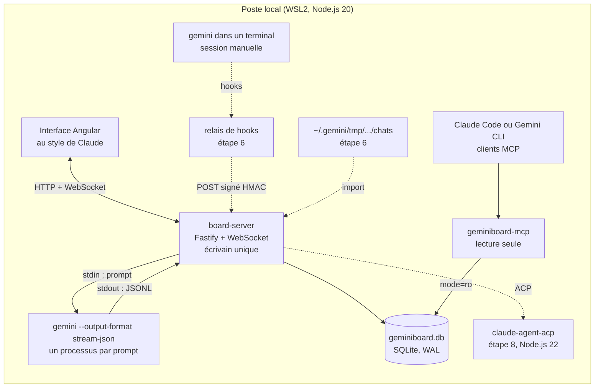
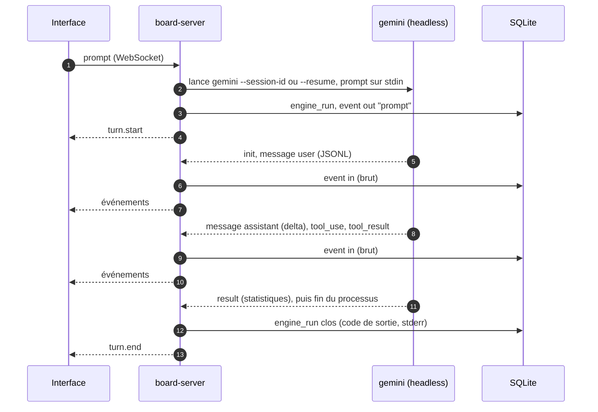
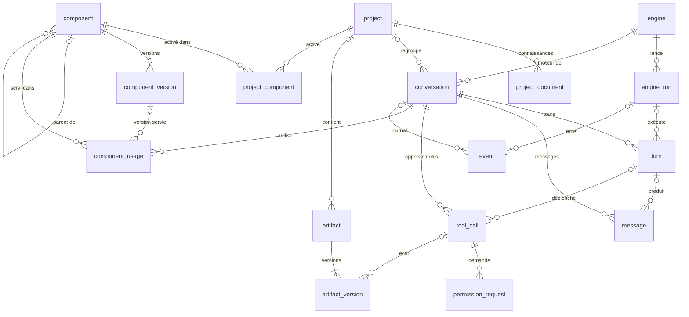

# GeminiBoard : cadrage

> **Statut** : v0.2 ratifiée le 25 octobre 2026 (PR #2) · étape 1 : spike fusionné (PR #3), corpus à collecter · étape 2 : migration, journal et projecteur fusionnés (PR #4), mémoire et Windows natif (PR #5), Windows ou WSL2 au choix et CI (PR #6), gestion des composants conçue (PR #7), ajustement au corpus réel à venir · étape 3 : skill de construction `geminiboard` 1.0.0 proposée (PR #8)
>
> **Portée de ce dépôt** : le cadrage, le code du board (D11) et les composants portables (D12).

GeminiBoard est une interface locale, au style de celle de Claude, qui pilote Gemini CLI et gère les discussions, les projets, les artefacts, les sous-agents, les skills, les commandes et les outils. Chaque échange et chaque action de gestion sont journalisés dans **un seul fichier SQLite**, conçu pour être relu par Claude le jour où le travail passera sur Claude. Les composants (skills, sous-agents, commandes, hooks) restent **portables entre Gemini CLI et Claude Code**.

---

## 1. Contexte

- Gemini CLI est l'outil de travail actuel ; le passage à Claude est prévu.
- Gemini CLI se prête mal à la conception de skills et d'agents complexes : ils sont conçus avec Claude, publiés sur GitHub, puis installés dans Gemini CLI.
- Il manque une vue d'ensemble : les sessions sont rangées par projet dans `~/.gemini/tmp/` (30 jours de rétention par défaut), les composants sont dispersés entre dossier utilisateur, espaces de travail et extensions, et les décisions (autorisations, ratifications) ne laissent aucune trace exploitable.
- Gemini CLI publie une version par semaine (v0.65.0 le 20 octobre 2026). Le board conserve donc les événements bruts et versionne ses analyseurs, pour encaisser les changements de format.
- Depuis le 18 juin 2026, Gemini CLI ne sert plus les comptes grand public (gratuit, Google AI Pro et Ultra) : il reste accessible avec une licence Gemini Code Assist Standard ou Enterprise, ou avec une clé d'API payante. Google oriente les autres vers Antigravity CLI (`agy`). Le board hérite de cette condition (§5.5).

GeminiBoard comble ce manque et prépare la transition : son journal devient la mémoire commune quand le travail se fera directement avec Claude.

## 2. Décisions déjà prises

| # | Décision | Date |
|---|---|---|
| D1 | Commandes au format TOML de Gemini CLI | 2026-10-24 |
| D2 | Skills et agents portables entre Gemini CLI et Claude | 2026-10-24 |
| D3 | Node.js ; Angular si le front est complexe | 2026-10-24 |
| D4 | Le schéma SQLite d'abord | 2026-10-24 |
| D5 | Interface au style de celle de Claude | 2026-10-24 |
| D6 | Travail en PR sur GitHub, ratification avant fusion | 2026-10-24 |
| D7 | Projet distinct, qui s'ajoute aux autres | 2026-10-24 |
| D8 | Journal des échanges et gestion dans un fichier SQLite unique, exploitable par Claude | 2026-10-24 |
| D9 | Capture : le board lance Gemini CLI à chaque prompt et relaie sa sortie standard vers l'interface (Q1) | 2026-10-25 |
| D10 | Toutes les bibliothèques sont compatibles avec Node.js 20 (Q2) | 2026-10-25 |
| D11 | Le code du board vit dans ce dépôt (Q5) | 2026-10-25 |
| D12 | Les composants portables vivent aussi dans ce dépôt (Q6) | 2026-10-25 |
| D13 | Le board tourne au choix sous Windows natif ou sous WSL2 (Q14) | 2026-10-25 |
| D14 | Catalogue : inventaire en lecture dès les étapes 4 et 5 ; écriture, ratification et extension de projet à l'étape 6 (Q16) | 2026-10-26 |
| D15 | Activation des composants par projet : extension de projet générée par le board (Q17) | 2026-10-26 |
| D16 | Le board n'écrit pas les fichiers internes de Gemini CLI : activation par `gemini extensions enable` et `disable` ; un agent du dépôt d'un projet se reconnaît dans un terminal ou s'adopte dans l'extension du projet (Q18) | 2026-10-26 |
| D17 | Seules les versions ratifiées s'activent dans un projet ; un brouillon s'essaie dans un projet de bac à sable (Q19) | 2026-10-26 |
| D18 | Inventaire de Claude Code dès l'étape 4, en lecture seule (Q20) | 2026-10-26 |

Le front visé (flux en continu, panneaux, catalogue) est complexe : ce cadrage retient donc Angular au titre de D3. D10 limite Angular aux versions 20 et 21 (Q3).

## 3. Objectifs et non-objectifs

| # | Objectif | Critère de vérification |
|---|---|---|
| O1 | Tout échange Gemini CLI est retrouvable | Une session lancée depuis le board **ou** depuis un terminal apparaît dans la base, avec ses messages, ses appels d'outils et ses décisions (terminal : étape 6) |
| O2 | L'état est reconstructible | Vider les tables de projection puis rejouer le journal `event` redonne le même état |
| O3 | Claude lit la base sans transformation | Claude répond à « qu'a-t-on décidé sur X ? » par le serveur MCP ou à partir du fichier joint |
| O4 | Un composant écrit une fois sert les deux moteurs | Un skill, une commande et un sous-agent s'installent dans Gemini CLI et dans Claude Code depuis ce dépôt |
| O5 | L'interface est accessible | Parcours clés au clavier et au lecteur d'écran ; cible RGAA 4.1 et WCAG 2.2, niveau AA |

Hors périmètre de la v1 : réimplémenter l'agent (le board pilote Gemini CLI, il ne le remplace pas), le multi-utilisateur, l'hébergement distant, la synchronisation dans le cloud, l'édition collaborative en temps réel.

## 4. Périmètre fonctionnel

| Module | Fonctions |
|---|---|
| Discussions | créer, reprendre, rechercher, renommer, épingler, archiver, bifurquer ; affichage en continu ; interruption ; choix du modèle et du mode d'approbation (`default`, `auto_edit`, `yolo`, `plan`), fixé avant l'envoi |
| Projets | dossier racine et son approbation par l'humain, dépôt, instructions injectées au début de chaque session (sans modifier les fichiers du dépôt), connaissances, composants activés, discussions, politique de capture |
| Artefacts | détection des fichiers écrits par les outils (`write_file`, `replace`), épinglage d'un bloc de code, versions, différences entre versions, export |
| Catalogue | skills, sous-agents, commandes, outils et serveurs MCP, hooks, politiques, fichiers de contexte, extensions : inventaire sur disque (Gemini CLI et Claude Code), versions, statut (brouillon, proposé, ratifié, obsolète), lien vers la PR, adoption, activation par projet par une extension de projet, usages, export vers Claude (§9) |
| Exécutions | lancer une commande ou un agent en lot, suivre le statut et le code de sortie |
| Journal | événements bruts filtrables (source, type, session), rejeu, export |
| Réglages | moteurs détectés et leurs versions, chemins, secret HMAC, motifs de masquage |

## 5. Architecture

### 5.1 Vue d'ensemble

Les liens en pointillés arrivent aux étapes 6 et 8 de la feuille de route.



- **Écrivain unique.** Seul `board-server` écrit dans la base, sur le modèle de l'agent médiateur d'Agent2Dev. Le relais de hooks lui transmettra ses événements ; le serveur MCP lit en lecture seule.
- **Journal d'abord.** Tout ce qui arrive (ligne JSONL, entrée de hook, action dans l'interface) est écrit tel quel dans `event`, puis projeté dans les tables métier. Un arrêt brutal ne perd rien : le rejeu reconstitue les messages à partir de leurs fragments.
- **Adaptateurs de moteur.** Un adaptateur par moteur et par canal : `gemini-cli` en headless pour la v1, puis ACP et `claude-code` à l'étape 8. Le reste du board ignore le moteur, ce qui prépare le passage à Claude.
- **Local.** Tout tourne sur le poste, sous Windows natif ou sous WSL2 au choix (D13, §5.4) ; le navigateur accède au board par `localhost`.

### 5.2 Composants et versions

| Paquet | Rôle | Technologie |
|---|---|---|
| `packages/server` (`board-server`) | lanceur de Gemini CLI (`run-gemini.mjs`), base et migrations (`journal.mjs`), écriture du journal (`recorder.mjs`), projecteur (`projector.mjs`) ; API HTTP et WebSocket à l'étape 4 | Node.js 20 (ES modules), better-sqlite3 ; Fastify et `@fastify/websocket` à l'étape 4 |
| `packages/ui` (`board-ui`) | interface | Angular, Angular CDK |
| `packages/hook` (`geminiboard-hook`) | relais des hooks de Gemini CLI (et de Claude Code) vers le serveur | script Node autonome, sans dépendance |
| `packages/mcp` (`geminiboard-mcp`) | lecture de la base par Claude ou Gemini | serveur MCP stdio, Node.js |
| `packages/cli` (`geminiboard`) | migrations, import, rejeu, export Markdown, génération des variantes Claude | Node.js |

Versions compatibles avec Node.js 20 (D10), vérifiées le 25 octobre 2026 :

| Bibliothèque | Version retenue | Contrainte Node.js |
|---|---|---|
| Gemini CLI (`@google/gemini-cli`) | 0.65.0, lancé par le board avec `node` et son point d'entrée `bundle/gemini.js` | 20 et plus ; exécuté ici sous Node.js 20.20.2 |
| better-sqlite3 | 12.9.0 | dernière version livrée avec des binaires précompilés pour Node.js 20 (Windows x64 et arm64, Linux x64) ; à partir de la 12.10, npm la compile à l'installation (outils C++ requis) ; la 13 exige Node.js 22 |
| Fastify / `@fastify/websocket` | 5.12.7 / 11.3.4 | testés ici sous Node.js 20.20.2, avec `light-my-request` épinglé en 6.6.0 (`overrides`) : sa version 6.8.0, tirée par défaut, dépend de `cookie` 2, qui exige Node.js 22 |
| Angular | 20.x ou 21.x | `^20.19.0` ; la 22 exige Node.js 22.22.3 ou plus |
| `node:sqlite` | écarté | absent de Node.js 20 |
| `@agentclientprotocol/claude-agent-acp` | étape 8 | exige Node.js 22 |

Contrats du serveur (esquisse, précisés à l'étape 4) :

- REST : `/api/projects`, `/api/conversations`, `/api/conversations/:id/timeline`, `/api/artifacts`, `/api/components`, `/api/events`, `/api/search`.
- WebSocket `/ws` : reçoit `prompt` et `cancel` ; émet `turn.start`, `event`, `turn.end`, `turn.error` (implémentation de référence au §6.3).
- Ingestion (étape 6) : `POST /ingest/hook`, signé par HMAC-SHA256 (en-tête `X-GeminiBoard-Signature`).

Stockage local :

```text
~/.geminiboard/
├── geminiboard.db      base SQLite (+ -wal, -shm)
├── blobs/              binaires adressés par sha256 (images, pièces jointes)
├── spool/              événements de hooks en attente si le serveur est arrêté
├── secret              clé HMAC (droits 600)
└── config.json
```

### 5.3 Interface au style de Claude

| Zone | Contenu | Équivalent Claude |
|---|---|---|
| Barre latérale | nouvelle discussion, recherche, discussions récentes et épinglées, projets, artefacts, catalogue, journal, réglages | barre latérale |
| Fil | Markdown rendu au fil de l'eau, cartes d'appels d'outils (statut, entrées, sortie, diff), outils refusés signalés, bouton Arrêter ; demandes d'autorisation en ligne avec ACP (étape 8) | fil de conversation |
| Saisie | palette `/` (commandes et skills du catalogue), `@` (fichiers, sous-agents), pièces jointes, choix du modèle et du mode d'approbation | zone de saisie |
| Panneau de droite | artefact ouvert (rendu, source, versions, diff, copie, téléchargement) ou fiche du projet | panneau d'artefacts |
| Page projet | instructions, connaissances, discussions, composants activés, dossier et son approbation, dépôt | Projets |
| Catalogue | listes par type ; fiche avec versions, contrôles, statut, PR et usages ; activation par projet ; adoption ; export vers Claude (§9.6) | propre à GeminiBoard |
| Journal | événements bruts, filtres, rejeu | propre à GeminiBoard |

Accessibilité (O5) : navigation complète au clavier, gestion du focus entre panneaux et dialogues, annonce du flux par une région `aria-live="polite"` phrase par phrase (et non jeton par jeton), contrastes de niveau AA, thèmes clair et sombre, respect de `prefers-reduced-motion`, repères et titres de page.

### 5.4 Mémoire et plateforme

Le poste a peu de mémoire : le board doit en consommer le moins possible.

Mesures du 25 octobre 2026, sous Linux avec Node.js 20.20.2 et Gemini CLI 0.65.0 réel, sur des tours courts arrêtés par une clé d'API invalide (pic de mémoire résidente du processus et de ses descendants) :

| Configuration | Pic de mémoire par tour | Durée d'un tour |
|---|---|---|
| Gemini CLI par défaut : il se relance dans un second processus Node.js, avec un tas de 50 % de la RAM | 461 à 465 Mo | 3,9 à 4,8 s |
| Board : `node` et `gemini.js`, relance désactivée (`GEMINI_CLI_NO_RELAUNCH`) | 267 à 283 Mo | 2,5 à 3,3 s |
| Board, tas plafonné à 512 Mo (`maxHeapMb`) | 273 à 275 Mo | — |
| `board-server` (esquisse du §6.3, faux Gemini CLI) | 78 Mo au repos, 81 Mo après 20 tours | — |

Sous Windows (GitHub Actions, Windows Server, même lancement que le board, trois exécutions) : 192 à 222 Mo par tour, pour le processus seul (`tasklist`), et 2,3 à 3,9 s par tour.

- Gemini CLI n'occupe de mémoire que pendant un tour : un processus par prompt (D9), qui se termine avec le tour. Au repos ne restent que `board-server` et l'onglet du navigateur.
- Par défaut, Gemini CLI se relance dans un second processus pour s'attribuer un tas égal à 50 % de la RAM (en interactif, aussi pour redémarrer après un changement d'authentification). En headless, le board désactive cette relance : un processus Node.js de moins (environ 180 Mo) et plus d'une seconde gagnée par tour. `relaunch: true` la rétablit ; `maxHeapMb` plafonne le tas.

WSL2 ou Windows natif, au choix (D13) :

| | WSL2 | Windows natif |
|---|---|---|
| Machine virtuelle | une seule, qui fait tourner toutes les distributions WSL2 ; mémoire plafonnée par défaut à 50 % de la RAM, plus un swap de 25 % ; cache de Linux récupéré par `autoMemoryReclaim` (`dropCache` par défaut) | aucune |
| Board allumé toute la journée | la VM reste allumée tant que `board-server` tourne ; sans lui, elle s'arrête après 60 s d'inactivité (`vmIdleTimeout`, Windows 11) | pas de VM à garder allumée |
| Docker Desktop, Rancher Desktop ou Podman sur WSL2 | la VM tourne de toute façon | gain limité à la mémoire que le board occuperait dans la VM |
| Commandes shell lancées par Gemini CLI | bash | PowerShell : `pwsh.exe` s'il est installé, sinon `powershell.exe` |
| Installation | Node.js 20 et Gemini CLI dans la distribution | Node.js 20 et Gemini CLI pour Windows |

Le code et ses tests tournent sur les deux plateformes :

- **Lancement** : `node` et le `gemini.js` du paquet, trouvé par `npm root -g` ou par `GEMINI_CLI_ENTRY` ; ni `gemini.cmd`, ni `cmd.exe`, ni shell.
- **Arrêt** : sous Windows, Node.js ne sait pas envoyer `SIGINT` (`kill()` y tue le processus net, sans ses descendants) ; le board utilise `taskkill /T /F`, qui arrête Gemini CLI et ses commandes. Le code de sortie n'y vaut pas 130 : le board journalise l'arrêt demandé (`turn.cancel`), qui fait foi pour le projecteur (§7.4).
- **Chemins** : reconnus à leur forme (`C:\…`, `\\serveur\…`), quel que soit le système, et comparés sans tenir compte de la casse ; un artefact garde un chemin relatif au projet, avec des `/`.
- **Spike** : masquage des formes Windows des chemins (barres inverses ou obliques, échappement JSON, noms courts comme `JEANDU~1`, casse), du nom d'utilisateur et du dossier d'installation de Gemini CLI ; mémoire mesurée par `tasklist`.
- **Fins de ligne** : `.gitattributes` impose LF, y compris dans un dépôt extrait sous Windows ; l'empreinte des migrations ignore CRLF.
- **Tests** : le faux Gemini CLI est lancé comme `gemini.js`, sans shell ; seul le test du raccourci `gemini` (mode `bin`) est sauté sous Windows.
- **CI** (GitHub Actions, à chaque push) : la suite de tests sous Ubuntu et sous Windows, avec Node.js 20 et 22, et un contrôle que better-sqlite3 s'installe sans compilation (`.github/workflows/tests.yml`) ; le vrai Gemini CLI, lancé par le spike avec une clé invalide, puis le spike S5 du catalogue (§9.4) et le contrôle de l'extension du dépôt (§9.7), sous Ubuntu et sous Windows, chaque lundi et à chaque changement du lanceur, du spike ou des composants (`.github/workflows/gemini-cli.yml`).

Conséquence pour les skills : leurs scripts s'écrivent en Node.js, qui tourne à l'identique sous bash et sous PowerShell, plutôt qu'en bash. C'est le cas de ceux de la skill `geminiboard` (étape 3), que les commandes `/board:*` lancent par le shell de Gemini CLI, PowerShell sous Windows.

Reste à vérifier sur le poste, avec un vrai compte : le spike le dira (S4, §12).

### 5.5 Installation et connexion de Gemini CLI

Le board n'a ni compte, ni clé, ni certification à lui : il lance le Gemini CLI de l'environnement où il tourne, avec la connexion de celui-ci. Seul Gemini CLI parle aux services de Google ; le board n'écoute que sur `127.0.0.1`.

| Étape | Windows natif (PowerShell) | WSL2 (bash) |
|---|---|---|
| Node.js 20 | installeur Windows de Node.js | nvm, ou paquet de la distribution |
| Gemini CLI | `npm install -g @google/gemini-cli` | la même commande, dans la distribution |
| Connexion de Gemini CLI | une fois, dans un terminal (tableau suivant) | la même chose, dans la distribution : la connexion faite sous Windows n'y sert pas |
| Board | `git clone`, `npm install`, `npm test` | les mêmes commandes |
| Base | `%USERPROFILE%\.geminiboard\geminiboard.db` | `~/.geminiboard/geminiboard.db` |

Chaque environnement a sa configuration Gemini CLI (`.gemini` : réglages, connexion, sessions) et sa base (`.geminiboard`). Une même base ne s'ouvre pas depuis les deux : le mode WAL de SQLite ne fonctionne pas sur un système de fichiers réseau, ce qu'est `/mnt/c` vu de WSL2.

Connexion de Gemini CLI, depuis le 18 juin 2026 (§1) :

| Accès | Mise en place |
|---|---|
| Licence Gemini Code Assist Standard ou Enterprise (compte d'entreprise) | lancer `gemini` une fois dans un terminal et se connecter avec le compte Google de l'entreprise ; définir `GOOGLE_CLOUD_PROJECT`, exigé pour ces comptes. Les identifiants restent en cache dans `.gemini/oauth_creds.json`, et le mode headless les réutilise |
| Clé d'API Gemini payante | `GEMINI_API_KEY`, dans l'environnement qui lance le board ou dans `.gemini/.env` |
| Compte grand public (gratuit, Google AI Pro ou Ultra) | plus servi par Gemini CLI : ni Gemini CLI ni le board ne répondent |

- Sans connexion valable, Gemini CLI sort avec le code 41, que le board affiche. Le board passe `NO_BROWSER=true` : sans cela, sur un poste qui a un navigateur (Windows notamment), un Gemini CLI non connecté demande sur son entrée standard l'accord d'ouvrir la page de connexion et prend le prompt pour la réponse (sortie 42, ou attente de la connexion si la première ligne du prompt est vide ou vaut « y »). Constaté sur Gemini CLI 0.65.0.
- Réseau d'entreprise : le proxy (`HTTPS_PROXY`) et son certificat racine (`NODE_EXTRA_CA_CERTS`, fichier PEM) se définissent dans l'environnement qui lance le board ; Gemini CLI en hérite.

## 6. Capturer la sortie de Gemini CLI

### 6.1 Principe retenu (D9)

Pour chaque prompt, le board lance un processus Gemini CLI en mode headless et relaie sa sortie standard vers l'interface. La sortie est demandée au format `stream-json` : une ligne JSON par événement, que le board journalise avant de la relayer. La discussion garde sa mémoire d'un prompt à l'autre : le board choisit l'identifiant de session (`--session-id <uuid>` au premier tour), puis reprend la même session (`--resume <uuid>`).



Corrections apportées à l'exemple proposé, vérifiées sur Gemini CLI 0.65.0 :

| Exemple proposé | Correction | Raison |
|---|---|---|
| `npx @google/gemini` | `node` et le point d'entrée `bundle/gemini.js` du paquet `@google/gemini-cli`, installé une fois | `@google/gemini` n'existe pas sur npm ; `npx` ajoute un délai à chaque prompt ; sous Windows, `node` évite le raccourci `gemini.cmd`, donc `cmd.exe` |
| prompt en argument positionnel | prompt écrit sur stdin | en 0.65, un argument positionnel ouvre le mode interactif ; un stdin non interactif bascule en headless et accepte jusqu'à 8 Mo |
| `shell: true` | pas de shell, y compris sous Windows | apostrophes, guillemets, `$()` ou `;` d'un prompt seraient interprétés par le shell : injection de commande |
| relance automatique de Gemini CLI | `GEMINI_CLI_NO_RELAUNCH=true` dans l'environnement du processus | un processus au lieu de deux : environ 280 Mo par tour au lieu de 460 (§5.4) |
| sortie texte | `--output-format stream-json` | événements typés à journaliser : `init`, `message`, `tool_use`, `tool_result`, `error`, `result` |
| morceaux bruts (`data`) | découpage par ligne (`readline`) | un morceau peut couper une ligne JSON en deux |
| une session par prompt | `--session-id <uuid>`, puis `--resume <uuid>` | sinon, chaque prompt repart sans la mémoire de la discussion |
| pas d'arrêt | `SIGINT`, puis `SIGKILL` après 5 s ; sous Windows, `taskkill /T /F` | bouton Arrêter |
| `import { Fastify } from 'fastify'` | `import Fastify from 'fastify'` | Fastify s'exporte par défaut |

### 6.2 Contraintes du mode headless (Gemini CLI 0.65.0)

- **Autorisations.** Personne ne peut confirmer un outil en cours de tour : le moteur de politiques transforme toute demande de confirmation en refus. Le mode d'approbation se choisit donc avant l'envoi : `default` (les outils à confirmer, comme l'écriture de fichiers ou le shell, sont refusés), `auto_edit` (modifications de fichiers acceptées), `yolo` (tout est accepté), `plan` (lecture seule). Des règles de politique (`policies/*.toml`) peuvent autoriser des commandes précises ; `--policy` remplace le dossier `~/.gemini/policies` de l'utilisateur, que le lanceur repasse donc en premier (§9.1).
- **Authentification.** Le mode headless réutilise la connexion en cache ou la clé d'API ; il ne sait pas se connecter seul. Le board passe `NO_BROWSER=true`, pour qu'un Gemini CLI non connecté sorte avec le code 41 au lieu de lire le prompt comme une réponse (§5.5).
- **Dossier approuvé.** Dans un dossier non approuvé, le mode headless s'arrête avec le code 55. Le board ne passe `--skip-trust` que pour un projet dont l'humain a approuvé le dossier (`project.trusted`), et journalise cette décision.
- **Création de la session.** Gemini CLI n'enregistre une session qu'après un tour abouti. Si le premier tour échoue (erreur d'API, par exemple), `--resume` sort ensuite avec le code 42 (« No previous sessions found for this project »). Le board ne reprend donc une session qu'après un `result` en succès ; sinon, il la recrée avec `--session-id`.
- **Relance.** Par défaut, Gemini CLI se relance dans un second processus Node.js avec un tas de 50 % de la RAM. En headless, cette relance ne sert qu'à agrandir le tas : le board la désactive (`GEMINI_CLI_NO_RELAUNCH`, §5.4).
- **Shell.** Les commandes de `run_shell_command` passent par bash sous Linux et WSL2, par PowerShell sous Windows (`pwsh.exe`, sinon `powershell.exe`). Une règle de politique (`commandPrefix`) vise la commande telle que le modèle l'écrit : `ls` fonctionne dans les deux cas (alias de `Get-ChildItem` dans PowerShell) ; `grep`, absent de Windows par défaut, non.
- **Codes de sortie.** 0 (succès), 1 (erreur générale), 41 (authentification), 42 (entrée invalide), 52 (configuration), 53 (limite de tours), 55 (dossier non approuvé), 130 (annulation). Une erreur d'API sort avec le statut HTTP : 400 sous Windows, où les codes de sortie tiennent sur 32 bits, et 144 ailleurs (400 modulo 256). Seul l'événement `result` fait foi.
- **Événements.** Tous portent `type` et `timestamp` ; champs propres à chaque type, relevés dans le code source (`packages/core/src/output/types.ts`) :

| Type | Champs |
|---|---|
| `init` | `session_id`, `model` |
| `message` | `role` (`user`, `assistant`), `content`, `delta` |
| `tool_use` | `tool_name`, `tool_id`, `parameters` |
| `tool_result` | `tool_id`, `status` (`success`, `error`), `output`, `error` |
| `error` | `severity` (`warning`, `error`), `message` |
| `result` | `status` (`success`, `error`), `error`, `stats` (`total_tokens`, `input_tokens`, `output_tokens`, `cached`, `input`, `duration_ms`, `tool_calls`, `models`) |

### 6.3 Implémentation de référence (Node.js 20)

Le lanceur [`packages/server/src/run-gemini.mjs`](packages/server/src/run-gemini.mjs) lance un tour. L'esquisse `server.mjs` ci-dessous s'appuie sur les modules de `packages/server/src` (journal, enregistreur, projecteur, lanceur) : elle expose le lanceur en WebSocket, journalise chaque événement, puis projette le tour clos ; elle entrera dans `packages/server` à l'étape 4.

Le texte saisi suit ce chemin : interface, WebSocket, `board-server`, puis entrée standard de Gemini CLI. Le board l'y écrit dès le lancement et la referme aussitôt (`child.stdin.end(prompt)`) : Gemini CLI lit l'entrée jusqu'à sa fin (8 Mo au plus) et la tient pour vide si rien n'arrive dans les 500 ms. La réponse revient sur la sortie standard, une ligne JSON par événement. Le prompt ne passe jamais par la ligne de commande : il n'apparaît ni dans `ps`, ni dans `engine_run.argv_json`. L'entrée standard ne sert qu'une fois par processus : le prompt suivant lance un nouveau processus, en `--resume`.

Vérifications du 25 octobre 2026 :

- Lanceur et spike : 21 tests contre un faux Gemini CLI lancé comme `gemini.js` (sans shell), sous Linux et sous Windows, avec Node.js 20 et 22 (ordre des événements, ligne JSON coupée en deux écritures, prompt piégé transmis intact, `--session-id` puis `--resume`, politiques, relance désactivée et plafond du tas, connexion absente sans question sur stdin, dossier des politiques de l'utilisateur conservé, codes 41, 42, 55, 130 et 144, binaire absent, point d'entrée relatif, paramètres refusés, masquage des chemins sous leurs formes Windows, mesure de la mémoire).
- Esquisse de serveur : 25 contrôles sous Node.js 20.20.2 (WebSocket de bout en bout, journal et projections, bouton Arrêter et onglet fermé consignés par `turn.cancel`, règle de reprise après un premier tour en erreur, reprise après un arrêt brutal, relance désactivée et plafond du tas).
- Contre Gemini CLI 0.65.0 réel : sans authentification, sortie 41 ; dans un dossier non approuvé, sortie 55 ; avec `--skip-trust` et une clé invalide, `init` (avec l'UUIDv7 fourni par le board), `message` (prompt intact), `result` en erreur, sortie 144 ; le tour suivant en `--resume` sort avec 42. Lancé comme le board (`node` et `gemini.js`, sans relance) : 267 à 283 Mo par tour.
- En CI (GitHub Actions), le spike contre Gemini CLI 0.65.0 réel avec une clé invalide : sous Ubuntu, sortie 144 et 230 à 262 Mo par tour ; sous Windows, sortie 400 et 192 à 222 Mo par tour (processus seul), sur trois exécutions ; ni chemin local ni nom d'utilisateur dans la sortie.

<details>
<summary><strong><code>server.mjs</code> (esquisse) : cliquer pour déplier</strong></summary>

```js
// server.mjs : esquisse du board-server. Une route WebSocket pilote Gemini CLI : chaque événement
// est journalisé dans SQLite et relayé à l'interface, puis le tour est projeté une fois clos.
// Node.js 20 ou plus : fastify 5, @fastify/websocket 11, better-sqlite3 12.9 ; Linux, WSL2 et Windows natif.
import Fastify from 'fastify';
import websocket from '@fastify/websocket';
import { homedir } from 'node:os';
import { join } from 'node:path';
import { pathToFileURL } from 'node:url';
import { openJournal } from './journal.mjs';
import { createProjector } from './projector.mjs';
import { createRecorder } from './recorder.mjs';
import { resolveGeminiEntry, runGemini } from './run-gemini.mjs';
import { uuidv7 } from './uuidv7.mjs';

// entry : gemini.js, lancé avec le node du board (sans shell, sans cmd.exe sous Windows)
// trusted : dossier approuvé par l'humain ; dans le board, lu dans project.trusted
export async function buildServer({ dbPath, entry = resolveGeminiEntry(), cwd = process.cwd(), trusted = false, maxHeapMb }) {
  if (!entry) throw new Error('Gemini CLI introuvable : « npm install -g @google/gemini-cli », ou définir GEMINI_CLI_ENTRY');
  const db = openJournal(dbPath); // migrations appliquées à l'ouverture
  const rec = createRecorder(db);
  const proj = createProjector(db);
  rec.recoverOpenRuns(); // tours restés ouverts après un arrêt brutal
  proj.projectPending();
  // Gemini CLI n'enregistre une session qu'après un tour abouti : sinon, --resume sort avec 42
  const sessionStarted = db.prepare(`SELECT 1 FROM event
    WHERE engine_session_id = ? AND source = 'headless' AND type = 'result'
      AND json_extract(payload_json, '$.status') = 'success' LIMIT 1`);

  const app = Fastify({ logger: false });
  await app.register(websocket);
  app.addHook('onClose', async () => db.close());

  // Reçus : { type: 'prompt', conversationId?, text, approvalMode?, model? } | { type: 'cancel' }
  // Émis  : turn.start, event, turn.end, turn.error
  app.get('/ws', { websocket: true }, (socket) => {
    let current = null;
    const send = (msg) => socket.send(JSON.stringify(msg));
    const cancel = () => {
      if (!current) return;
      rec.cancel({ runId: current.runId, sessionId: current.sessionId }); // fait foi, même sans code 130 (Windows)
      current.handle.cancel();
    };

    socket.on('message', async (raw) => {
      let msg;
      try { msg = JSON.parse(raw.toString()); } catch { return send({ type: 'turn.error', message: 'JSON invalide' }); }
      if (msg.type === 'cancel') return cancel();
      if (msg.type !== 'prompt' || typeof msg.text !== 'string') return;
      if (current) return send({ type: 'turn.error', message: 'un tour est déjà en cours' });

      const sessionId = msg.conversationId ?? uuidv7();
      const resume = Boolean(sessionStarted.get(sessionId));
      const runId = uuidv7();
      const approvalMode = msg.approvalMode ?? 'default';
      let handle;
      try {
        // Le texte saisi est écrit sur l'entrée standard de Gemini CLI, jamais sur sa ligne de commande
        handle = runGemini({
          prompt: msg.text, cwd, sessionId, resume, approvalMode, model: msg.model, skipTrust: trusted, entry, maxHeapMb,
          onEvent: (event) => {
            rec.event({ runId, sessionId, event });
            send({ type: 'event', conversationId: sessionId, event });
          },
        });
      } catch (e) {
        return send({ type: 'turn.error', conversationId: sessionId, message: e.message });
      }
      current = { handle, runId, sessionId };
      // Synchrone, donc écrit avant le premier événement reçu
      rec.start({ runId, sessionId, cwd, args: handle.args, pid: handle.pid ?? null, prompt: msg.text, approvalMode, resume });
      send({ type: 'turn.start', conversationId: sessionId, resume });

      try {
        const r = await handle.done;
        rec.end({ runId, code: r.code, stderr: r.stderr });
        send({ type: 'turn.end', conversationId: sessionId, code: r.code, meaning: r.meaning });
      } catch (e) {
        rec.end({ runId, code: null, stderr: e.message });
        send({ type: 'turn.error', conversationId: sessionId, message: e.message });
      } finally {
        current = null;
        proj.projectPending(); // discussion, tour, messages, appels d'outils, artefacts
      }
    });

    socket.on('close', cancel);
  });

  return app;
}

// Lancement direct : node server.mjs (base par défaut : ~/.geminiboard/geminiboard.db)
if (process.argv[1] && import.meta.url === pathToFileURL(process.argv[1]).href) {
  const app = await buildServer({
    dbPath: process.env.GEMINIBOARD_DB ?? join(homedir(), '.geminiboard', 'geminiboard.db'),
  });
  await app.listen({ host: '127.0.0.1', port: Number(process.env.PORT ?? 3210) });
}
```

</details>

### 6.4 Canaux complémentaires

| Canal | Étape | Usage |
|---|---|---|
| Hooks (`hooks/hooks.json` des extensions de projet → `geminiboard-hook`) | 6 | sessions lancées à la main dans un terminal (O1) : `SessionStart`, `BeforeAgent`, `BeforeTool`, `AfterTool`, `AfterAgent`, `SessionEnd` |
| Import de `~/.gemini/tmp/<project_hash>/chats/` | 6 | rattrapage de l'historique ; format non documenté |
| ACP (`gemini --acp`) | 8 | autorisations en cours de tour ; même protocole pour Claude Code avec `claude-agent-acp`, qui exige Node.js 22 |

Une session moteur ne donne qu'une discussion (`UNIQUE (engine_id, engine_session_id)`), projetée par un seul canal ; les autres restent consignés dans le journal brut.

Le relais de hooks obéira à trois règles :

1. Il n'écrit sur stdout que `{}` et sort avec le code 0 : il n'influe jamais sur les décisions de Gemini CLI.
2. Il poste l'entrée reçue au serveur avec une signature HMAC et un délai court ; si le serveur ne répond pas, il ajoute l'événement au `spool/`, que le serveur ingère au démarrage.
3. Par défaut, il ne s'abonne ni à `BeforeModel`, ni à `AfterModel`, ni à `BeforeToolSelection` : leur entrée contient la requête complète envoyée au modèle (volume important, données sensibles).

```json
{
  "hooks": {
    "BeforeTool": [
      {
        "matcher": "*",
        "hooks": [
          {
            "name": "geminiboard",
            "type": "command",
            "command": "node \"$HOME/.geminiboard/bin/geminiboard-hook.mjs\"",
            "timeout": 2000
          }
        ]
      }
    ]
  }
}
```

La même entrée sera déclarée pour `SessionStart`, `BeforeAgent`, `AfterTool`, `AfterAgent`, `SessionEnd`, `Notification` et `PreCompress`. Plutôt que dans `~/.gemini/settings.json`, elle ira dans le `hooks/hooks.json` de chaque extension de projet (§9.4), au même format : les réglages de l'utilisateur restent intacts.

## 7. Schéma SQLite

Source : [`migrations/001_init.sql`](migrations/001_init.sql), appliquée par `packages/server/src/journal.mjs`. Évolutions depuis la v0 du cadrage : colonne `turn.error_message` ; identifiant d'appel d'outil unique par tour, et non plus par discussion, car chaque tour headless est un nouveau processus.

### 7.1 Principes

- Un fichier unique, mode WAL, clés étrangères actives, tables `STRICT`.
- Le journal brut `event` est en ajout seul (garanti par des triggers) et constitue la seule source de vérité. Les autres tables sont des projections reconstructibles ; chaque événement traité porte la version du projecteur.
- Le projecteur (`packages/server/src/projector.mjs`) traite un tour d'un bloc, dans une transaction, une fois son exécution close. Les horodatages viennent des événements et la clé d'un artefact dérive de son chemin (UUID version 8) : le rejeu est déterministe.
- Une migration appliquée ne se modifie plus (empreinte sha256 vérifiée à l'ouverture) : toute évolution passe par un fichier `002_*.sql`.
- Une session moteur correspond à une seule discussion, quel que soit le canal. En headless, l'identifiant de la discussion sert d'identifiant de session à Gemini CLI.
- Clés : UUIDv7 (texte) pour les entités exposées dans les URL, l'API et le MCP (projet, discussion, artefact, composant, exécution) ; entiers pour les tables à fort volume, dont le rowid stable sert de clé aux index plein texte.
- Recherche plein texte FTS5 insensible aux accents (`unicode61 remove_diacritics 2`) sur les messages, les artefacts et les connaissances.
- Binaires hors base (`blobs/`, adressés par sha256) ; textes en base.
- Le catalogue versionne chaque composant avec un statut de ratification, calqué sur le cycle proposer, ratifier, appliquer.
- Les décisions humaines (approbation d'un dossier, autorisations, ratifications, retours) sont des données de premier rang.

### 7.2 Diagramme



### 7.3 Tables

| Groupe | Table | Contenu |
|---|---|---|
| Méta | `schema_migration`, `setting` | migrations appliquées (avec leur sha256), réglages |
| Moteurs | `engine` | `gemini-cli`, `claude-code`, version détectée |
| | `engine_run` | processus lancé par le board : canal, argv (sans le prompt), pid, code de sortie, fin de stderr |
| Projets | `project` | dossier racine et son approbation (`trusted`), dépôt, instructions, `gemini_project_hash`, politique de capture |
| | `project_document` | connaissances du projet (texte indexé ou binaire) |
| Discussions | `conversation` | moteur, `engine_session_id`, canal, modèle, mode d'approbation, statut, discussion parente |
| | `turn` | un prompt et ses suites : statut, raison d'arrêt, message d'erreur, jetons, durée, commande d'origine |
| | `message` | rôles `user`, `assistant`, `thought`, `system` ; séquence partagée avec `tool_call` |
| | `tool_call` | outil, nature (`read`, `edit`, `execute`…), identifiant d'appel unique dans le tour, entrées, sortie, fichiers touchés, statut, composant concerné |
| | `permission_request` | options proposées, décision, auteur de la décision (`human`, `policy`, `hook`, `auto`) ; alimentée à partir de l'étape 8 (ACP) |
| Artefacts | `artifact`, `artifact_version` | fichier ou bloc suivi ; versions avec leur origine (outil, message, humain) |
| Catalogue | `component` | skill, sous-agent, commande, hook, serveur MCP, outil, extension, fichier de contexte, politique ; portée, dépôt source, cibles (`gemini`, `claude`, `both`) |
| | `component_version` | contenu, empreinte, statut (`draft`, `proposed`, `ratified`, `deprecated`), commit, PR |
| | `project_component` | activation par projet, version épinglée |
| | `component_usage` | quelle version a servi dans quelle discussion (`activated`, `invoked`, `delegated`, `fired`, `blocked`) |
| Journal | `event` | entrée brute (`headless`, `hook`, `import`, `acp`, `pty`, `board`), sens, type, session, charge JSON, état de projection |
| Retours | `feedback` | note et commentaire sur un message, un appel, un tour ou une version |
| Lecture | `v_timeline`, `v_conversation_overview`, `v_component_current` | vues stables pour l'interface, le serveur MCP et Claude |

### 7.4 Règles de projection

Règles appliquées par `projector.mjs` (version 2) :

| Entrée | Projection |
|---|---|
| Prompt envoyé (`event` sortant `prompt`) | discussion créée au premier tour (`channel = headless`, identifiant = identifiant de session, titre tiré de la première ligne, projet dont le dossier contient `cwd`, sans tenir compte de la casse pour un chemin Windows) ; nouveau `turn` ; `message` `user` avec le texte envoyé ; commande d'origine si le prompt commence par `/` |
| `message` `user` (écho de Gemini CLI) | reste dans le journal, sans doublon dans `message` |
| `init` | modèle du tour et de la discussion |
| `message` `assistant` | fragments réunis en un seul message, clos au premier `tool_use`, au `result` ou à la fin du tour |
| `tool_use`, puis `tool_result` | `tool_call` (clé : `tool_id` dans le tour) : `completed` ou `failed`, sortie, erreur, durée ; sans résultat : `failed`, ou `cancelled` si le tour est annulé |
| `activate_skill`, `invoke_agent` | `component_usage` (`activated`, `delegated`), avec la version courante du composant s'il est au catalogue |
| `write_file` réussi ; `replace` réussi avec instantané | `artifact` (clé dérivée du projet et du chemin relatif) et nouvelle `artifact_version`. L'instantané (`artifact.snapshot`, écrit par le serveur après relecture du fichier) prime sur le contenu de `write_file` ; un `replace` sans instantané ne crée pas de version |
| `error` | reste dans le journal ; son message sert d'erreur du tour à défaut de `result` |
| `result` | tour clos : `success` donne `completed`, `error` donne `error` (raison : `error.type`, message : `error.message`) ; jetons et durée tirés de `stats` |
| `turn.cancel` (arrêt demandé par l'humain, action du board) | tour `cancelled`, sauf si un `result` en succès est arrivé ; vaut aussi sous Windows, où l'arrêt ne donne pas le code 130 |
| Fin du processus sans `result` | 130 ou signal : `cancelled` ; 53 : `limit` ; autre code : `error`, avec la dernière ligne de stderr |
| `project.upsert` (action du board) | `project` créé ou mis à jour |
| `conversation.delete` (action du board) | discussion supprimée avec ses projections ; le journal reste et le rejeu respecte la suppression |
| Tour resté ouvert après un arrêt du serveur | clos au redémarrage (`recoverOpenRuns`), puis projeté comme annulé |
| Hooks, import, ACP (étapes 6 et 8) | marqués traités, sans projection, jusqu'à leur étape |

### 7.5 Tests

`npm install`, puis `npm test` (Node.js 20) : 63 tests, dont 62 passent et 1 attend un corpus réel ; sous Windows, 61 passent et 2 sont sautés (s'y ajoute le test du raccourci `gemini`).

- Schéma (6) : migration et empreintes, lecture seule, contraintes, plein texte insensible aux accents, journal en ajout seul, vues.
- Projecteur (13) : tour simple, outils et chronologie, `result` en erreur, fins sans `result`, tours successifs, artefacts et instantanés, composants, tour ouvert et reprise après arrêt, suppression, reconstruction à l'identique (O2), chemins POSIX et Windows, projet Windows trouvé sans tenir compte de la casse, arrêt demandé (`turn.cancel`).
- Rejeu de corpus (3) : un corpus synthétique produit par le spike avec le faux Gemini CLI, le même converti en corpus Windows (plateforme `win32`, chemins à barres inverses), puis chaque dossier `fixtures/spike-*` présent dans le dépôt. Chaque tour est vérifié (statut, message utilisateur, appels d'outils, texte de la réponse), puis la base est reconstruite à l'identique.
- Lanceur (14) et spike (7).
- Composants (11) : analyse du TOML et du frontmatter, injections `!{…}` et `@{…}`, politiques, renvois, chaque règle de contrôle sur un dépôt synthétique, composants de ce dépôt conformes (§9.7).
- Scripts de la skill `geminiboard` (9) : compatibilité des bibliothèques avec Node.js 20, données sensibles, lignes ajoutées d'un diff, lecture du README et des migrations, `etat.mjs` et `verifier.mjs` lancés sur ce dépôt.

Vérifié le 25 octobre 2026 en local sous Node.js 20.20.2 (trois exécutions) et 22.23 après une installation propre, puis en CI sous Ubuntu et sous Windows avec Node.js 20 et 22 : better-sqlite3 est un module natif, et changer de version de Node.js impose `npm rebuild`. Les corpus produits par Gemini CLI 0.65.0 réel sans compte valide (authentification absente, erreur d'API, reprise impossible) se rejouent aussi à l'identique.

## 8. Lecture par Claude

Deux voies, au choix selon le contexte.

**Voie 1 : serveur MCP `geminiboard-mcp`** (stdio, lecture seule), déclaré dans Claude Code comme dans Gemini CLI. Gemini peut ainsi interroger son propre historique.

| Outil | Rôle |
|---|---|
| `search` | recherche plein texte dans les messages, les artefacts et les connaissances, filtrable par projet et par période |
| `list_conversations` | discussions récentes, par projet |
| `get_conversation` | une discussion en Markdown : messages, appels d'outils résumés, décisions |
| `get_artifact` | un artefact, à une version donnée |
| `list_components` | catalogue, avec version courante et statut |
| `query` | requête `SELECT` libre : connexion `mode=ro`, `PRAGMA query_only`, nombre de lignes plafonné |

**Voie 2 : fichier joint.** La base, ou un export filtré (`geminiboard export --project <slug>`), est jointe à une session Claude, qui l'interroge en SQL.

Un skill portable, `geminiboard-journal`, indique aux deux moteurs quand et comment interroger le journal. Le contrat de lecture repose sur les vues `v_*` : toute modification passe par une migration et une note de version.

## 9. Composants : gestion et portabilité

Le catalogue (§4) gère tout ce qui oriente la conduite de Gemini CLI en dehors du prompt : skills, sous-agents, commandes, outils intégrés et serveurs MCP, hooks, politiques, fichiers de contexte, extensions. Il les inventorie, les versionne, les fait ratifier, les active projet par projet, suit leurs usages et prépare leur passage à Claude Code. Les composants de référence vivent dans ce dépôt (D12).

### 9.1 Ce que Gemini CLI 0.65 charge

Relevé dans le code de Gemini CLI 0.65.0 et vérifié sur des installations de démonstration, sous Linux et sous Windows, les 25 et 26 octobre 2026. Les emplacements sont donnés dans l'ordre où Gemini CLI les charge ; pour les skills, le dernier chargé l'emporte en cas de nom identique.

| Type | Emplacements | Activation et désactivation | Usage observé |
|---|---|---|---|
| Skill | intégrés (`skill-creator`, `antigravity-support`) ; extensions ; `~/.gemini/skills`, `~/.agents/skills` ; `.gemini/skills`, `.agents/skills` du projet, si le dossier est approuvé | `skills.disabled` ; `gemini skills enable`, et `disable` en portée utilisateur ou espace de travail ; `install`, `link`, `uninstall` | outil `activate_skill` (`name`), à confirmer en interactif et refusé en headless sauf règle `allow` ; aussi en commande : `/nom`, ou toujours `/<extension>:nom` pour une skill d'extension |
| Sous-agent | intégrés ; `.gemini/agents/*.md` du projet, si le dossier est approuvé **et** l'agent reconnu (empreinte du fichier dans `~/.gemini/acknowledgments/agents.json`) ; `~/.gemini/agents/*.md` ; `agents/` des extensions | `experimental.enableAgents` (vrai par défaut) ; `agents.overrides.<nom>.enabled` ; frontmatter strict : `kind`, `name`, `description`, `display_name`, `tools`, `mcp_servers`, `model`, `temperature`, `max_turns`, `timeout_mins`, toute autre clé est refusée | outil `invoke_agent` (`agent_name`) |
| Commande | `~/.gemini/commands`, `.gemini/commands` du projet, `commands/` des extensions ; s'y ajoutent les prompts des serveurs MCP et les skills | pas de désactivation unitaire ; en cas de conflit, Gemini CLI renomme selon l'origine (`<extension>:`, `user.`, `workspace.`, `<serveur MCP>.`) | `/ns:nom` en tête du prompt (`turn.command_name`) |
| Serveur MCP et ses outils | `mcpServers` des réglages de l'utilisateur et du projet ; `mcpServers` du manifeste d'une extension | `mcp.allowed`, `mcp.excluded` ; `~/.gemini/mcp-server-enablement.json` (`gemini mcp enable`, `disable`) ; `--allowed-mcp-server-names`, qui remplace `mcp.allowed` pour l'exécution ; valeurs `$VAR`, `${VAR}` et `${VAR:-défaut}` résolues depuis l'environnement | outils `mcp_<serveur>_<outil>`, coupés au premier `_` : un nom de serveur sans `_` |
| Outil intégré | registre de Gemini CLI : `read_file`, `read_many_files`, `list_directory`, `glob`, `grep_search`, `write_file`, `replace`, `run_shell_command`, `web_fetch`, `google_web_search`, `write_todos`, `update_topic`, `activate_skill`, `invoke_agent`, `ask_user`, `enter_plan_mode`, `exit_plan_mode`… | politiques ; `tools.core` (liste blanche), `tools.exclude` ; `excludeTools` du manifeste d'une extension | `tool_use` et `tool_result` ; un refus par politique arrive en `tool_result` en erreur |
| Politique | règles par défaut de Gemini CLI ; `policies/` des extensions ; `~/.gemini/policies/*.toml` ; politiques système ; `--policy` par exécution | champs `toolName`, `mcpName`, `subagent`, `commandPrefix`, `commandRegex`, `argsPattern`, `modes`, `decision` (`allow`, `deny`, `ask_user`), `priority` | refus en `tool_result` |
| Hook | `hooks` des réglages ; `hooks/hooks.json` d'une extension | `hooksConfig.enabled`, `hooksConfig.disabled` ; hooks du projet seulement si le dossier est approuvé | relais de hooks (étape 6) |
| Fichier de contexte | `~/.gemini/GEMINI.md` ; `GEMINI.md` du projet et de ses dossiers ; noms réglés par `context.fileName` ; `contextFileName` d'une extension | toujours lu | — |
| Extension | `~/.gemini/extensions/<nom>`, installée (`gemini extensions install`) ou liée (`link`) | règles par chemin dans `~/.gemini/extensions/extension-enablement.json` (`gemini extensions enable`, `disable`) ; `-e` par exécution, `-e none` pour aucune | à travers ses composants |
| Réglages | `~/.gemini/settings.json` ; `.gemini/settings.json` du projet ; réglages système et d'administration (`admin.*`) | lecture seule pour le board | — |

Il n'y a pas d'outil `save_memory` en 0.65 : la mémoire passe par l'édition des fichiers `GEMINI.md` et d'un index `MEMORY.md` propre au projet. Les listes de désactivation (`skills.disabled`, `extensions.disabled`, `hooksConfig.disabled`, `tools.exclude`) se cumulent entre portées : une portée peut ajouter une désactivation, pas en retirer une.

Constats qui pèsent sur la conception :

- **Politiques.** Niveaux, du plus fort au plus faible : administration, utilisateur, espace de travail, extension, défaut. `--policy` remplace le dossier `~/.gemini/policies`, qui n'est alors plus chargé : le lanceur le repasse donc en premier ; les deux ont le niveau utilisateur. Gemini CLI ignore les règles `allow` d'une extension, ainsi que ses règles pour le mode `yolo` : une extension ne peut que refuser ou faire demander, et ses règles cèdent devant celles de l'utilisateur. `--admin-policy` est ignoré quand des politiques système existent, ce qui protège le poste d'entreprise.
- **Commandes en headless.** Une commande TOML qui contient `!{…}` s'arrête en headless, sauf si une politique autorise la commande shell qu'elle lance : la confirmation est impossible. La commande autorisée doit rester simple : enchaînée (`;`, `&&`, `|`) ou redirigée (`>`), elle est refusée même si sa première partie est couverte. Ce dépôt fournit la politique de ses propres commandes (§9.7).
- **Réglages système.** Un fichier de réglages système (`GEMINI_CLI_SYSTEM_SETTINGS_PATH`, `GEMINI_CLI_SYSTEM_DEFAULTS_PATH`) doit appartenir à root, ou aux administrateurs sous Windows, et n'être modifiable par personne d'autre : Gemini CLI ignore tout autre fichier. Le board ne peut donc pas s'en servir comme calque.
- **Outils de Gemini CLI.** `gemini extensions list -o json` donne les extensions avec leurs skills, leurs sous-agents et leur état d'activation pour le dossier courant (`isActive`), tels que Gemini CLI les voit ; en 0.65, ce JSON sort sur stderr. `gemini skills list` n'a qu'une sortie texte. `gemini mcp list` démarre les serveurs pour tester leur connexion.

### 9.2 Inventaire

- **Sources.** Ce dépôt, pour les composants de référence (D12), puis d'autres dépôts GitHub, Agent2Prompt par exemple ; le disque, aux emplacements du §9.1, pour Gemini CLI et pour Claude Code (`~/.claude`, `.claude`), en lecture seule (D18) ; `gemini extensions list -o json`, pour les extensions.
- **Sans effet de bord.** Le scan lit les fichiers sans rien lancer : pas de `gemini mcp list`.
- **Journalisé.** Un événement `catalog.scan` (board, interne) donne, par composant, le type, le nom, la portée, le chemin et l'empreinte sha256 de l'arborescence ; les contenus vont dans `blobs/`. Le projecteur en tire `component` et `component_version` : le catalogue se reconstruit comme le reste (O2).
- **Version.** La semver déclarée (manifeste d'extension, `version` du frontmatter) quand elle existe, sinon les 12 premiers caractères de l'empreinte.
- **Agents de projet.** Le scan calcule l'empreinte de chaque fichier et la compare à `acknowledgments/agents.json` : un agent non reconnu est signalé.
- **Dérive.** La CI hebdomadaire comparera l'inventaire du board à `gemini skills list` et à `gemini extensions list -o json`, sur une installation de démonstration.

### 9.3 Cycle de vie

Calqué sur le cycle proposer, ratifier, appliquer :

| Statut | Signification | Action journalisée |
|---|---|---|
| `draft` | composant édité dans le board ou dans ce dépôt, sur une branche | `component.edit` |
| `proposed` | contrôles passés, PR ouverte sur ce dépôt (`pr_url`) | `component.propose` |
| `ratified` | PR fusionnée ; la version porte le commit de fusion (`git_ref`) | `component.ratify` |
| `deprecated` | retiré des activations, conservé dans l'historique | `component.deprecate` |

Contrôles avant la proposition, journalisés (`component.check`) et gardés avec la version :

| Type | Contrôles |
|---|---|
| Skill | `name` et `description` dans le frontmatter, et rien d'autre pour rester portable (§9.7) ; nom égal au dossier ; fichiers cités présents |
| Sous-agent | clés du frontmatter strict de Gemini CLI seulement (§9.1) ; outils connus ; variantes Gemini et Claude générées depuis la source neutre |
| Commande | TOML valide ; `prompt` présent ; `{{args}}`, `!{…}` et `@{…}` bien formés ; commande shell de `!{…}` couverte par une politique |
| Politique | TOML valide ; règles complètes ; aucune règle `allow` destinée à une extension |
| Serveur MCP | nom sans `_` ; aucun secret en clair (motifs de masquage, §11) |
| Extension de projet | `gemini extensions validate` |

Pour les composants de ce dépôt, ces contrôles existent dès l'étape 3 : `tools/check-components.mjs`, sans Gemini CLI, dans la suite de tests ; `tools/check-extension.mjs`, sur le vrai Gemini CLI, en CI (§9.7). Le board les reprendra à l'étape 6.

Un composant trouvé hors du dépôt (installé à la main) peut être adopté : il est copié dans ce dépôt, puis suit le même cycle (`component.adopt`). Seules les versions ratifiées s'activent dans un projet ; un brouillon s'essaie dans un projet de bac à sable (D17).

### 9.4 Activation par projet : l'extension de projet (D15)

Pour chaque projet, le board génère une extension Gemini CLI, `gb-<projet>`, à partir du catalogue :

```text
~/.geminiboard/extensions/gb-<projet>/
├── gemini-extension.json    nom, version, contextFileName, serveurs MCP activés, outils masqués (excludeTools)
├── GEMINI.md                instructions du projet (§4), injectées sans toucher au dépôt
├── skills/<nom>/            version épinglée de chaque skill activée
├── agents/<nom>.md          sous-agents activés
├── commands/<ns>/<nom>.toml commandes activées
├── hooks/hooks.json         hooks activés (dont le relais du board, étape 6)
└── policies/<nom>.toml      règles de refus et de demande propres au projet
```

- **Liée une fois.** `gemini extensions link` n'écrit qu'une métadonnée vers ce dossier (`.gemini-extension-install.json`) : ni copie, ni lien symbolique, donc aucun droit particulier sous Windows. Chaque génération se voit aussitôt. Gemini CLI demande un accord sur stdin ; le board le donne après la ratification humaine, et le journalise.
- **Active sous la racine du projet seulement.** Le board désactive l'extension depuis la racine de chaque lecteur (`gemini extensions disable --scope workspace`), puis l'active depuis la racine du projet (`enable --scope workspace`) : règles `["!/*", "<racine>/*"]` dans `extension-enablement.json`, écrites par les commandes publiques de Gemini CLI (D16). La portée `user` ne suffirait pas : elle ne couvre que le dossier personnel, et un projet situé ailleurs (`D:\dev`, `/opt`) verrait l'extension active.
- **Mêmes composants à la main.** Une session lancée dans un terminal, dans le dossier du projet, voit les composants du board (O1). Le board ajoute `-e` à ses propres exécutions, pour n'y charger que les extensions prévues.
- **Autorisations.** L'extension ne peut pas autoriser (§9.1) : les autorisations du projet passent par `--policy` à chaque exécution du board, avec le mode d'approbation. Elles comprennent l'activation des skills du projet : en headless, Gemini CLI 0.65 refuse `activate_skill` par défaut, comme `run_shell_command`, `write_file`, `replace` et `web_fetch` ; une règle `allow` par skill, limitée à son nom (`argsPattern`), la rend possible. Une restriction qui doit tenir dans les exécutions du board y figure aussi, puisque les règles de l'extension cèdent devant celles de niveau utilisateur. Une session lancée à la main demandera donc confirmation, ce qui est voulu.
- **Versions épinglées réelles.** L'extension contient la version épinglée, même si le dépôt avance. Un sous-agent d'extension n'a pas à être reconnu. Chaque composant s'active seul. `gemini extensions validate` contrôle l'extension générée.
- **Entre deux tours.** Le board ne régénère jamais l'extension pendant un tour du projet ; chaque génération est journalisée (`extension.materialize`, avec l'empreinte de l'arborescence).
- **Composants hors board** (`~/.gemini/skills`, réglages de l'utilisateur…) : inventoriés, suivis à l'usage, toujours actifs. Le board ne les modifie pas ; il propose de les adopter. Il n'écrit pas non plus dans le `.gemini/` du dépôt d'un projet.
- **Agents du dépôt du projet** (`.gemini/agents`) : non reconnus, Gemini CLI ne les charge pas en headless. Le board le signale et propose de les reconnaître dans un terminal, ou de les adopter dans l'extension du projet après relecture (décision journalisée).
- **Noms d'appel.** Le board applique les règles de préfixe de Gemini CLI (§9.1) et signale les conflits avant d'activer.
- **Serveurs MCP.** `--allowed-mcp-server-names` remplaçant `mcp.allowed`, le board n'y passe que des serveurs déjà permis par ce réglage. Leurs secrets ne vont jamais dans la base : le manifeste porte des références `$VAR`, résolues dans l'environnement qui lance Gemini CLI.

Sans le board, le dépôt reste installable en entier comme extension (§9.7) : tout y est alors actif partout.

Vérifié par le spike S5 (`spike/catalogue.mjs`), sans compte, dans un `GEMINI_CLI_HOME` temporaire : une extension de projet générée (skill, sous-agent, commande, politique, serveur MCP, outil masqué, fichier de contexte) est validée, liée, désactivée depuis la racine puis activée pour le seul dossier du projet. Depuis ce dossier, la skill est visible ; depuis un autre projet ou depuis le dossier personnel, elle ne l'est pas ; la règle `allow` de l'extension est ignorée. Contrôlé sous Linux et sous Windows, à chaque changement du spike et chaque lundi (CI).

Voies écartées :

| Voie | Pourquoi l'écarter |
|---|---|
| `.gemini/settings.json` du projet | écrit dans le dépôt |
| calque de réglages système | refusé par Gemini CLI, faute d'appartenir à root (§9.1), et il remplacerait celui de l'administrateur |
| `GEMINI_CLI_HOME` propre à chaque projet | déplace aussi la connexion, les sessions et l'historique |
| options par exécution seules (`-e`, `--policy`) | sans effet sur les sessions lancées à la main |
| politiques seules, en refusant `activate_skill` ou `invoke_agent` pour un nom | le modèle voit encore les skills et sous-agents refusés, et perd des tours à les essayer |

### 9.5 Usages

- L'événement `prompt` porte la liste des composants actifs du tour (type, nom, empreinte) : chaque usage se rattache à la version réellement employée, y compris après une reconstruction.
- Règles de projection prévues : `activate_skill` donne `activated` ; `invoke_agent`, `delegated` ; `mcp_<serveur>_<outil>`, `invoked` sur le serveur MCP (nature d'outil `mcp`, déjà prévue par le schéma) ; un prompt `/ns:nom`, `invoked` sur la commande ; un outil refusé par une politique, `blocked` ; un hook, `fired` (étape 6).
- Vues : composants inutilisés, usages par projet et par version.

### 9.6 Interface et schéma

- **Page Catalogue.** Listes par type ; filtres par portée, source, projet, statut et moteur ; fiche avec versions, différences entre versions, contrôles, statut, PR, projets où le composant est actif, usages ; alertes : contrôle en échec, agent non reconnu, extension de projet qui a dérivé. Actions : activer ou désactiver dans un projet, épingler une version, adopter, proposer, ratifier, rendre obsolète, exporter vers Claude.
- **Page du projet, onglet Composants.** Vue effective (ce que Gemini CLI chargera dans le dossier du projet), bascules d'activation, versions épinglées, bouton Appliquer qui régénère l'extension et en montre la différence.
- **Schéma.** Migration `002_catalogue.sql`, à l'étape 6 ; essayée sur le schéma 001, elle passe :

```sql
CREATE TABLE catalog_source (                          -- sources du catalogue : dépôts GitHub ou dossiers
  id         TEXT PRIMARY KEY,                         -- UUIDv7
  kind       TEXT NOT NULL CHECK (kind IN ('github','local')),
  location   TEXT NOT NULL UNIQUE,                     -- 'FredGarcia/geminiboard-cadrage' ou chemin
  ref        TEXT,                                     -- branche, tag ou commit suivi
  synced_at  TEXT
) STRICT;
ALTER TABLE component ADD COLUMN engine_id TEXT REFERENCES engine(id);   -- moteur de l'instance ; NULL : référence
ALTER TABLE component ADD COLUMN source_id TEXT REFERENCES catalog_source(id);
ALTER TABLE component ADD COLUMN origin_id TEXT REFERENCES component(id) ON DELETE SET NULL;  -- composant de référence
DROP INDEX ux_component_identity;
CREATE UNIQUE INDEX ux_component_identity
  ON component(ifnull(engine_id, ''), kind, scope, ifnull(project_id, ''), ifnull(parent_id, ''), name);
ALTER TABLE component_version ADD COLUMN checks_json TEXT
  CHECK (checks_json IS NULL OR json_valid(checks_json));               -- contrôles (§9.3)
ALTER TABLE project_component ADD COLUMN applied_version_id INTEGER
  REFERENCES component_version(id);                                      -- version présente dans l'extension
CREATE TABLE project_extension (                       -- extension générée pour un projet et un moteur
  project_id    TEXT NOT NULL REFERENCES project(id) ON DELETE CASCADE,
  engine_id     TEXT NOT NULL REFERENCES engine(id),
  name          TEXT NOT NULL UNIQUE,                  -- 'gb-<projet>'
  path          TEXT NOT NULL,
  sha256        TEXT NOT NULL,                         -- empreinte de l'arborescence générée
  generated_at  TEXT NOT NULL,
  PRIMARY KEY (project_id, engine_id)
) STRICT;
```

S'y ajoutera une vue de comparaison entre le catalogue et le disque (à jour, modifié, absent).

### 9.7 Portabilité Gemini CLI ↔ Claude Code

État au 25 octobre 2026 (sources en fin de document) :

| Élément | Gemini CLI | Claude Code | Stratégie |
|---|---|---|---|
| Skill | `SKILL.md` (standard Agent Skills) dans `.gemini/skills/` ou son alias `.agents/skills/`, dans `~/.gemini/skills/` ou dans une extension ; activé par l'outil `activate_skill` ; `gemini skills install <url git>` | `SKILL.md` (même standard) dans `.claude/skills/`, `~/.claude/skills/` ou un plugin | **Source unique** ; frontmatter limité à `name` et `description` ; dossiers `scripts/`, `references/`, `assets/` |
| Commande | TOML dans `.gemini/commands/<ns>/<nom>.toml`, appelée par `/ns:nom` ; champs `prompt` et `description` ; `{{args}}`, `!{…}`, `@{…}` | Markdown dans `.claude/commands/`, ou skill ; `description`, `argument-hint` ; `$ARGUMENTS`, ``!`…` ``, `@fichier` | **Source TOML** (D1) ; variante Claude générée |
| Sous-agent | `.gemini/agents/<nom>.md`, frontmatter `name`, `description`, `tools`, `mcp_servers`, `model`, `temperature`, `max_turns`, `timeout_mins` ; actifs par défaut (`experimental.enableAgents`) ; un agent de projet doit être reconnu (§9.1) | `.claude/agents/<nom>.md`, frontmatter `name`, `description`, `tools`, `model`… | source neutre ; deux variantes générées (correspondance des outils ci-dessous) |
| Hooks | `settings.json` ou `hooks/hooks.json` d'une extension ; stdin avec `session_id`, `transcript_path`, `cwd`, `hook_event_name`, `timestamp` ; code 2 pour bloquer ; `timeout` en millisecondes | `settings.json` ou `hooks/hooks.json` d'un plugin ; stdin avec `session_id`, `transcript_path`, `cwd`, `hook_event_name`, `permission_mode` ; code 2 pour bloquer ; `timeout` en secondes | un seul script Node ; correspondance des événements ci-dessous ; délais convertis |
| Contexte | `GEMINI.md` ; `context.fileName` accepte `AGENTS.md` ; `contextFileName` dans une extension ; imports `@fichier.md` | `CLAUDE.md`, ou `AGENTS.md` lu nativement en l'absence de `CLAUDE.md` (v2.1.277 et suivantes) ; imports `@chemin` | **`AGENTS.md` comme source unique** |
| Distribution par GitHub | extension : `gemini-extension.json` à la racine ; `gemini extensions install <url> [--ref] [--auto-update]` | plugin : `.claude-plugin/plugin.json`, publié par une marketplace (`.claude-plugin/marketplace.json`) | ce dépôt sert les deux (arborescence ci-dessous) |

Conversion d'une commande TOML en commande Markdown pour Claude :

| TOML (Gemini CLI) | Markdown (Claude Code) |
|---|---|
| `description = "…"` | frontmatter `description: …` |
| `prompt = """…"""` | corps du fichier |
| `{{args}}` | `$ARGUMENTS` |
| `@{chemin}` | `@chemin` |
| `!{commande}` | ``!`commande` ``, avec un `allowed-tools` adapté |
| `commands/git/commit.toml`, appelée par `/git:commit` | `commands/git-commit.md`, appelée par `/<plugin>:git-commit` |

Correspondance des outils (sous-agents) :

| Gemini CLI | Claude Code |
|---|---|
| `read_file`, `read_many_files` | `Read` |
| `write_file` | `Write` |
| `replace` | `Edit` |
| `run_shell_command` | `Bash` |
| `glob` | `Glob` |
| `grep_search` | `Grep` |
| `web_fetch` | `WebFetch` |
| `google_web_search` | `WebSearch` |
| `activate_skill` | `Skill` |

Correspondance des événements de hooks :

| Gemini CLI | Claude Code |
|---|---|
| `SessionStart` | `SessionStart` |
| `BeforeAgent` | `UserPromptSubmit` |
| `BeforeTool` | `PreToolUse` |
| `AfterTool` | `PostToolUse` |
| `AfterAgent` | `Stop` |
| `PreCompress` | `PreCompact` |
| `Notification` | `Notification` |
| `SessionEnd` | `SessionEnd` |
| `BeforeModel`, `AfterModel`, `BeforeToolSelection` | pas d'équivalent direct |

Arborescence de ce dépôt (D11, D12) : à la fois extension Gemini CLI, marketplace Claude Code et code du board.

```text
geminiboard-cadrage/
├── README.md                          # ce cadrage
├── gemini-extension.json              # extension Gemini CLI, à la racine ; contextFileName = AGENTS.md
├── AGENTS.md                          # contexte, source unique
├── skills/
│   └── geminiboard/                   # skill de construction (étape 3) ; geminiboard-journal à l'étape 7
│       ├── SKILL.md                   # méthode, invariants, index des références et des scripts
│       ├── references/                # architecture, invariants, gemini-cli, etapes, tests, redaction
│       ├── scripts/                   # etat.mjs, verifier.mjs, et leur module commun depot.mjs
│       └── assets/politique-headless.toml # politique des commandes /board:* en headless
├── commands/board/<nom>.toml          # /board:etape, verifier, revue, pr, migration (source TOML)
├── agents/relecteur-board.md          # sous-agent, variante Gemini, écrite à la main jusqu'à l'étape 8
├── hooks/hooks.json                   # hooks, variante Gemini (relais geminiboard-hook, étape 6)
├── src/agents/<nom>.md                # sous-agents, source neutre (étape 8)
├── claude-plugin/                     # plugin Claude Code, généré (étape 8)
│   ├── .claude-plugin/plugin.json
│   ├── skills/<nom>/SKILL.md          # copie des skills
│   ├── commands/<ns>-<nom>.md         # générées depuis commands/*.toml
│   ├── agents/<nom>.md                # variante Claude
│   └── hooks/hooks.json               # variante Claude
├── .claude-plugin/marketplace.json    # marketplace Claude ; source du plugin : ./claude-plugin (étape 8)
├── packages/                          # code du board : server, puis ui, hook, mcp, cli
├── migrations/001_init.sql
├── fixtures/                          # corpus collectés par le spike
├── spike/                             # spikes S1 à S5
└── tools/                             # tests et CI ; check-components.mjs, check-extension.mjs ; port.mjs (étape 8)
```

Pourquoi un sous-dossier pour Claude : un plugin Claude charge toujours le `hooks/hooks.json` de sa racine (le manifeste ne fait que s'y ajouter) et ses chemins doivent rester sous sa racine. Placé à la racine du dépôt, il lirait les hooks au format Gemini ; d'où un plugin généré dans `claude-plugin/`, avec une copie des skills. `tools/check-components.mjs` contrôle déjà les invariants des composants : frontmatter des skills, nom de skill égal au nom du dossier, fichiers cités présents, TOML valide, injections couvertes par une politique, outils connus de Gemini CLI. `tools/port.mjs` y ajoutera la génération des variantes et la correspondance des outils des deux côtés.

Conséquence de D11 : `gemini extensions install https://github.com/FredGarcia/geminiboard-cadrage` copie tout le dépôt, code du board compris (sans `node_modules`, qui n'est pas versionné).

**Installer l'extension du dépôt dans Gemini CLI.** Elle apporte la skill `geminiboard`, les commandes `/board:*` et le sous-agent `relecteur-board`, et charge `AGENTS.md` comme contexte. Elle ne doit être active que dans le clone du dépôt : ailleurs, son contexte et ses commandes s'inviteraient dans toutes les sessions. Les commandes suivantes se lancent dans un terminal, PowerShell ou bash, une par une :

| Étape | Commande |
|---|---|
| 1. Lier le clone | `gemini extensions link <chemin du clone>`, puis accepter ; liée, l'extension suit la branche du clone, ce qui convient pour construire le board. À défaut, une copie : `gemini extensions install https://github.com/FredGarcia/geminiboard-cadrage`, mise à jour par `gemini extensions update geminiboard` |
| 2. La désactiver partout | depuis la racine de chaque lecteur (`C:\`, `D:\`… sous Windows ; `/` sous WSL2) : `gemini extensions disable --scope workspace geminiboard` |
| 3. L'activer dans le clone | depuis la racine du clone : `gemini extensions enable --scope workspace geminiboard` |
| 4. Vérifier | `gemini extensions list` : active dans le clone, inactive ailleurs |

- **Commandes `/board:*`.** Elles lancent les scripts de la skill par des injections `!{…}` et demandent au modèle d'activer la skill : en interactif, Gemini CLI demande confirmation pour l'un et l'autre ; en headless, il les refuse (§9.1), sauf avec la politique fournie, passée depuis la racine du clone : `gemini --policy skills/geminiboard/assets/politique-headless.toml`. Une extension ne peut pas autoriser : cette politique n'est donc pas dans un dossier `policies/`.
- **Claude Code.** Il lit `AGENTS.md`, qui l'envoie vers `skills/geminiboard/SKILL.md`, en attendant le plugin de l'étape 8.
- **Contrôles.** `tools/check-components.mjs`, dans `npm test` ; `tools/check-extension.mjs`, en CI : sur le vrai Gemini CLI, sans compte, dans un dossier personnel temporaire, l'extension est validée et liée ; la skill, le sous-agent et le fichier de contexte sont chargés ; chaque commande est refusée en headless sans la politique et passe avec elle ; la sortie des scripts figure dans le prompt envoyé au modèle. Vérifié le 26 octobre 2026 avec Gemini CLI 0.65.0.

## 10. Lecture 7E

> « Les Éléments dans l'Espace Engendrent un État d'Expression Évolutif de l'Environnement »

| Terme | Dans GeminiBoard |
|---|---|
| Éléments | les entités du schéma : projets, discussions, tours, messages, appels d'outils, artefacts, composants |
| Espace | le fichier SQLite unique et l'espace de travail : dossiers racine, `~/.gemini`, dépôts GitHub |
| Engendrent | les événements bruts (stream-json, puis hooks, import et ACP, actions du board), écrits dans `event` |
| État | les projections, reconstructibles par rejeu |
| Expression | l'interface, les vues `v_*`, l'export Markdown, le serveur MCP |
| Évolutif | les versions des composants (du brouillon à la ratification), les migrations, la version du projecteur |
| Environnement | Gemini CLI, Claude Code, GitHub, le système de fichiers, et l'humain qui approuve, autorise et ratifie |

Second ordre : les décisions de l'observateur (approbations, autorisations, ratifications, retours) sont journalisées comme des données. Les agents les relisent par le serveur MCP et ajustent leur conduite ; le système s'observe en train d'être utilisé.

## 11. Sécurité et confidentialité

- Écoute sur `127.0.0.1` uniquement ; le board n'envoie aucune donnée hors du poste.
- Le prompt passe par stdin, jamais par une ligne de commande ni par un shell : pas d'injection, pas de prompt visible dans `ps`.
- `--skip-trust` seulement pour un dossier approuvé par l'humain dans le board (`project.trusted`), décision journalisée.
- Le board ne détient aucun identifiant : la connexion et les clés restent celles de Gemini CLI (`.gemini`, variables d'environnement), qu'il ne lit pas.
- Relais de hooks authentifié par HMAC-SHA256 (secret local, droits 600).
- Masquage avant écriture : motifs de secrets configurables (clés d'API, jetons, en-têtes `Authorization`) ; la colonne `event.redacted` trace leur application.
- Politique de capture par projet : `full`, `metadata` (sans contenu) ou `off`.
- La base n'est jamais versionnée. Ce dépôt public ne contient ni données ni extraits de session.
- Lecture par Claude : connexion `mode=ro` et `query_only` ; export filtré pour toute transmission hors du poste.
- Node.js 20 ne reçoit plus de correctifs de sécurité depuis le 30 avril 2026 (Q12).

## 12. Feuille de route

Chaque étape se termine par une ratification en PR.

| Étape | Livrable | Point de ratification |
|---|---|---|
| 0. Cadrage | ce README, décisions D1 à D12 | fusion de cette PR |
| 1. Spike de capture | `spike/capture.mjs` fusionné (PR #3) ; reste à le lancer sur le poste avec un vrai compte (licence Gemini Code Assist Standard ou Enterprise, ou clé d'API payante, §5.5) et à committer le corpus dans `fixtures/` | corpus |
| 2. Schéma v1 | `migrations/001_init.sql`, journal, projecteur et rejeu des fixtures (PR #4) ; mémoire et Windows natif (PR #5) ; reste l'ajustement au corpus réel | schéma v1 |
| 3. Skill de construction | skill `geminiboard` (méthode, invariants, références, scripts `etat.mjs` et `verifier.mjs`), commandes TOML `/board:*` et sous-agent `relecteur-board`, qui guident Gemini CLI dans la construction du board ; extension du dépôt et ses contrôles (PR #8, §9.7) | skill 1.0.0 |
| 4. Serveur | `packages/server` : lanceur, journal, projecteur, API, WebSocket ; inventaire du catalogue, en lecture (§9.2, D14) | une discussion de bout en bout ; inventaire du poste |
| 5. Interface | Angular : barre latérale, fil en continu, mode d'approbation, panneau d'artefacts ; page Catalogue en lecture (listes, fiches, usages) | parcours au clavier et au lecteur d'écran |
| 6. Catalogue et capture passive | cycle de vie, contrôles et ratification, adoption, extension de projet (activation, épinglage, politiques), agents non reconnus signalés, migration `002_catalogue.sql` ; relais de hooks, livré dans les extensions de projet ; import des sessions | catalogue v1, O1 vérifié |
| 7. Lecture par Claude | `geminiboard-mcp`, skill `geminiboard-journal`, export | O3 vérifié |
| 8. Portabilité et ACP | `tools/port.mjs`, extension et plugin depuis ce dépôt ; ACP pour les autorisations en cours de tour et le moteur Claude (Node.js 22) | O4 vérifié |

Points à trancher par le spike, sur le poste et avec un vrai compte :

- **S1.** Corpus `stream-json` réel : tours avec outils, fragments `delta`, erreurs `error` et `result`.
- **S2.** Reprise `--resume <uuid>` sur plusieurs tours ; comportement si deux tours visent la même session.
- **S3.** Effet réel des modes d'approbation et des règles `policies/*.toml` en headless.
- **S4.** Délai de démarrage et mémoire d'un processus par prompt, sur le poste (Windows natif ou WSL2).
- **S5.** Activation des composants par extension de projet (§9.4) : vérifiée le 26 octobre 2026 par `spike/catalogue.mjs`, sans compte, sous Linux et sous Windows (CI).

Points repoussés : format des fichiers de session et déclenchement des hooks (étape 6), ACP et `claude-agent-acp` (étape 8).

Tests : le projecteur est vérifié en rejouant les fixtures du spike ; l'interface, par des tests de bout en bout Playwright (le même outillage qu'Agent2Test).

## 13. Questions ouvertes

| # | Question | Proposition ou décision |
|---|---|---|
| Q1 | Canaux de capture | **Tranchée (D9)** : un processus par prompt, sortie relayée en `stream-json` ; hooks et import à l'étape 6, ACP à l'étape 8 |
| Q2 | Pilote SQLite | **Tranchée (D10)** : better-sqlite3 12.9.0, dernière version précompilée pour Node.js 20 (les suivantes se compilent à l'installation ; la 13 exige Node.js 22 ; `node:sqlite` n'existe pas en Node.js 20) |
| Q3 | Version d'Angular | 20, comme le socle back-front d'Agent2Prompt, ou 21 ; la 22 est exclue par D10 |
| Q4 | Bibliothèque de composants | Angular CDK et composants maison, pour coller au style de Claude ; Angular Material en option |
| Q5 | Dépôt du code | **Tranchée (D11)** : ce dépôt |
| Q6 | Dépôt des composants portables | **Tranchée (D12)** : ce dépôt |
| Q7 | Rétention du journal brut | conservation intégrale ; un compactage des fragments après projection exigerait une exception au principe d'ajout seul |
| Q8 | Capture par défaut des projets professionnels | `metadata`, avec passage à `full` projet par projet |
| Q9 | Moteur `claude-code` dans le board | à l'étape 8, avec ACP ; exige Node.js 22 |
| Q10 | Fichier de contexte | `AGENTS.md` comme source unique ; pour ce dépôt, Gemini CLI le charge comme fichier de contexte de l'extension du dépôt (`contextFileName`, §9.7), sans toucher aux réglages de l'utilisateur, et Claude Code le lit de lui-même (proposé) |
| Q11 | Mode d'approbation par défaut d'une nouvelle discussion | `default` ; `auto_edit` ou `yolo` sur choix explicite, journalisé |
| Q12 | Passage à Node.js 22 | Node.js 20 n'a plus de correctifs depuis le 30 avril 2026 ; Node.js 22 ouvrirait Angular 22, better-sqlite3 13 et `claude-agent-acp` |
| Q13 | Nom du dépôt | le renommer `geminiboard` maintenant qu'il porte le code (GitHub redirige l'ancienne adresse) |
| Q14 | Plateforme du poste | **Tranchée (D13)** : Windows natif ou WSL2, au choix ; le natif évite de garder une machine virtuelle allumée, sauf si Docker Desktop ou un équivalent l'utilise déjà (§5.4) |
| Q15 | Moteur Antigravity CLI (`agy`) | à évaluer si l'accès d'entreprise à Gemini CLI venait à cesser ; un adaptateur de plus (§5.1), au même titre que `claude-code` |
| Q16 | Place du catalogue dans la feuille de route | **Tranchée (D14)** : inventaire en lecture dès les étapes 4 (serveur) et 5 (interface) ; écriture, ratification et extension de projet à l'étape 6 |
| Q17 | Activation par projet | **Tranchée (D15)** : extension de projet générée par le board (§9.4), plutôt que des réglages d'espace de travail, qui modifieraient le dépôt, ou que des options par exécution seules, sans effet sur les sessions lancées à la main |
| Q18 | Fichiers internes de Gemini CLI (`extension-enablement.json`, `acknowledgments/agents.json`) | **Tranchée (D16)** : le board ne les écrit pas lui-même ; l'activation passe par les commandes publiques `gemini extensions enable` et `disable`, vérifiées par le spike S5 ; un agent du dépôt se reconnaît dans un terminal, ou s'adopte dans l'extension du projet |
| Q19 | Versions activables dans un projet | **Tranchée (D17)** : ratifiées seulement ; un brouillon s'essaie dans un projet de bac à sable |
| Q20 | Inventaire de Claude Code | **Tranchée (D18)** : dès l'étape 4, en lecture seule, pour préparer la transition |

## 14. Références

Consultées le 25 octobre 2026.

**Gemini CLI**

- [Headless mode](https://www.geminicli.com/docs/cli/headless) · [ACP mode](https://geminicli.com/docs/cli/acp-mode/) · [CLI reference](https://geminicli.com/docs/cli/cli-reference) · [Trusted folders](https://geminicli.com/docs/cli/trusted-folders/)
- [Hooks](https://geminicli.com/docs/hooks/) · [Hooks reference](https://geminicli.com/docs/hooks/reference)
- [Agent Skills](https://geminicli.com/docs/cli/skills/) · [Creating Agent Skills](https://geminicli.com/docs/cli/creating-skills/)
- [Custom commands](https://www.geminicli.com/docs/cli/custom-commands) · [Session management](https://geminicli.com/docs/cli/session-management/)
- [Extension reference](https://geminicli.com/docs/extensions/reference/) · [GEMINI.md](https://geminicli.com/docs/cli/gemini-md/) · [Tools reference](https://geminicli.com/docs/reference/tools) · [Policy engine](https://geminicli.com/docs/core/policy-engine)
- [Subagents have arrived in Gemini CLI](https://developers.googleblog.com/en/subagents-have-arrived-in-gemini-cli/)
- [Release v0.65.0](https://github.com/google-gemini/gemini-cli/releases/tag/v0.65.0) · code source : événements `stream-json` dans `packages/core/src/output/types.ts`, options `--acp` et `--experimental-acp` dans `packages/cli/src/config/config.ts`, champs des sous-agents dans `packages/core/src/agents/agentLoader.ts` ; aide (`gemini --help`), codes de sortie et politiques du paquet npm 0.65.0 ; catalogue (§9.1) : `SkillManager.discoverSkills`, `AgentRegistry.loadAgents` et `AcknowledgedAgentsService`, `ExtensionEnablementManager`, `McpServerEnablementManager`, `SlashCommandResolver`, `loadExtensionPolicies`, `getPolicyDirectories`, vérifiés avec `gemini extensions link`, `extensions list -o json`, `skills list`, `skills disable`, `mcp add` sur une installation de démonstration

**Agent Client Protocol**

- [Protocol overview](https://agentclientprotocol.com/protocol/overview)
- [SDK TypeScript `@agentclientprotocol/sdk`](https://github.com/agentclientprotocol/typescript-sdk) · [adaptateur `@agentclientprotocol/claude-agent-acp`](https://github.com/agentclientprotocol/claude-agent-acp)

**Claude Code**

- [Skills](https://code.claude.com/docs/en/skills) · [Subagents](https://code.claude.com/docs/en/sub-agents) · [Hooks](https://code.claude.com/docs/en/hooks)
- [Plugin manifest reference](https://code.claude.com/docs/en/plugins-reference) · [Memory, CLAUDE.md et AGENTS.md](https://code.claude.com/docs/en/memory)

**Node.js 20**

- Compatibilités relevées dans le registre npm (`engines` de better-sqlite3, @angular/core, @google/gemini-cli, light-my-request et cookie) et dans les binaires précompilés publiés avec chaque version de better-sqlite3 · fin de support : [Node.js v20 goes EOL April 30](https://www.herodevs.com/blog-posts/node-js-v20-goes-eol-april-30----and-your-cloud-provider-is-pulling-the-plug-the-next-day)

**Accès à Gemini CLI**

- [An important update: Transitioning Gemini CLI to Antigravity CLI](https://developers.googleblog.com/en/an-important-update-transitioning-gemini-cli-to-antigravity-cli/) (Google, 19 mai 2026) · [Authentication](https://geminicli.com/docs/get-started/authentication/)
- Code de Gemini CLI 0.65.0 (paquet npm) : `validateNonInteractiveAuth`, `initOauthClient`, `getConsentForOauth` (accord lu sur stdin en headless), `NO_BROWSER`

**Windows et WSL2**

- [Advanced settings configuration in WSL](https://learn.microsoft.com/en-us/windows/wsl/wsl-config) (`.wslconfig` : `memory`, `swap`, `vmIdleTimeout`, `autoMemoryReclaim`) · [Write-Ahead Logging](https://www.sqlite.org/wal.html) (WAL et systèmes de fichiers réseau)
- Code de Gemini CLI 0.65.0 (paquet npm) : relance et `GEMINI_CLI_NO_RELAUNCH` dans `packages/cli/index.ts`, choix du shell sous Windows dans `getShellConfiguration`, lecture de stdin dans `readStdin`

**Standard** : [Agent Skills](https://agentskills.io)
